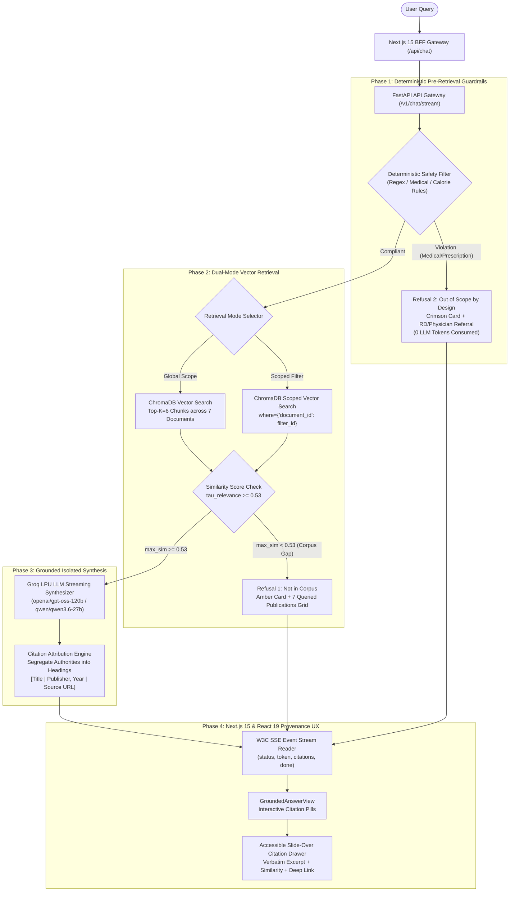

# Dietary Guidance RAG Chatbot

An authoritative, deterministic, and verifiable Retrieval-Augmented Generation (RAG) conversational system grounded strictly in public health and safe food handling guidance from authoritative agencies: the **World Health Organization (WHO)**, **Food and Agriculture Organization (FAO)**, **U.S. Food and Drug Administration (FDA)**, **USDA Food Safety and Inspection Service (FSIS)**, and **UK Food Standards Agency / Public Health England (UK FSA / PHE)**.

Built with **Python 3.11+**, **FastAPI**, **ChromaDB**, **Sentence-Transformers**, **Groq LPU Inference SDK**, and a **Next.js 15 (App Router)** & **React 19** frontend featuring **W3C Server-Sent Events (SSE)** real-time streaming, interactive citation provenance pills, an accessible slide-over provenance drawer, and a developer diagnostic explorer.

---

## 1. System Architecture



---

## 2. Authoritative Corpus Registry

The system operates strictly on **1,001 pre-parsed canonical structural blocks** across **7 authoritative public health publications** codified in `config/corpus_registry.yaml`. **Zero external web scraping, live downloads, or PDF parsing occur during runtime or ingestion.**

| Document ID | Official Title | Issuing Agency / Publisher | Year | Category | Blocks | Tables | Pages |
|---|---|---|---|---|---|---|---|
| `cold-food-storage` | Cold Food Storage Chart | U.S. FDA / FoodSafety.gov | 2021 | Food Safety | 3 | 1 mega-table (53 rows) | Web |
| `who-healthy-diet` | Healthy Diet Fact Sheet N°394 | World Health Organization (WHO) | 2020 | Nutrition | 92 | 0 | 1–6 |
| `fao-who-healthy-diets` | Sustainable Healthy Diets: Guiding Principles | FAO & WHO | 2019 | Nutrition | 98 | 0 | 8–21 |
| `who-five-keys` | Five Keys to Safer Food Manual | World Health Organization (WHO) | 2006 | Food Safety | 174 | 0 | 5–28 |
| `eatwell-guide` | The Eatwell Guide: Helping you eat a balanced diet | PHE / NHS / UK FSA | 2018 | Nutrition | 120 | 3 (2 atomic, 1 mega) | 2–10 |
| `fsa-chill` | Chilling Food Correctly | UK Food Standards Agency (FSA) | 2020 | Food Safety | 45 | 0 | Web |
| `kitchen-companion` | Kitchen Companion: Your Safe Food Handbook | USDA FSIS | 2008 | Food Safety | 469 | 8 (7 atomic, 1 mega) | 6–44 |
| **Total** | **7 Canonical Guidance Publications** | **5 Global Public Health Authorities** | — | — | **1,001** | **12 Tables** | — |

---

## 3. Data-Calibrated Chunk Assembly & Trade-off Record

### 3.1 Why Naive Fixed-Token Chunking Fails
Standard RAG implementations slice text using blind sliding windows (e.g., 500 characters with 50-character overlap). On authoritative dietary corpora, this causes severe degradation:
1. **Destructive Table Bisecting**: Splits multi-column tables mid-row or mid-cell. An inquiry like *"How long can chicken stay in the freezer?"* receives isolated rows detached from the column headers (`Refrigerator` vs `Freezer`), inducing dangerous hallucinations.
2. **Context Orphanage**: Detaches bulleted items from parent introductory rules (e.g., WHO sugar threshold rules).
3. **Hierarchy Dilution**: Discards section context, confusing refrigerator guidelines with pantry guidance.

### 3.2 The Hierarchy-Aware Chunking Strategy
The `HierarchyChunker` (`src/ingestion/block_chunker.py`) implements a data-calibrated strategy tailored to the 1,001 blocks:
- **Embedding Window Calibration**: Targets 250–350 WordPiece tokens (strict 450-token ceiling) to avoid silent tail truncation in dense models like `all-MiniLM-L6-v2`.
- **Atomic Table Preservation (9 of 12 tables)**: Tables under 450 tokens are emitted 100% intact as standalone single-block chunks without row or cell splitting.
- **Segmented Mega-Table Row Clustering (3 of 12 tables)**:
  - `cold-food-storage` ordinal 2 (53 rows, ~1,375 tokens): Partitioned into 4 balanced thematic sub-tables ($\le 400$ tokens each) with **100% replicated complete 4-column headers**:
    `| Food | Type | Refrigerator [40°F (4°C) or below] | Freezer [0°F (-18°C) or below] |`
  - `eatwell-guide` ordinal 105 (6 food groups, ~1,200 tokens): Partitioned into 3 sub-tables preserving all 4 columns (`Food group`, `What’s included?`, `How much?`, `Tips`).
  - `kitchen-companion` ordinal 216 (11 roasting rows, ~580 tokens): Partitioned into 2 sub-tables with replicated roasting temperature and timing headers.
- **List-to-Lead Binding**: Binds narrative lead-in sentences to their child bullet items (`list_item`).
- **Hierarchy Breadcrumbs**: Automatically prepends hierarchical path breadcrumbs (`" > ".join(heading_path)`) to every chunk.

---

## 4. Dual-Mode Vector Retrieval & Similarity Thresholding

### 4.1 Calibrated Relevance Threshold ($\tau = 0.53$)
Dense cosine similarity scores generated by `all-MiniLM-L6-v2` were empirically profiled across in-corpus queries and out-of-corpus queries:
- Relevant in-corpus queries (e.g., *"How long can chicken stay in the fridge?"*, *"WHO sugar limits"*): produce similarity scores between **0.62 and 0.88**.
- Out-of-corpus queries (e.g., *"Can I store raw camel milk at 25°C for a week?"*, *"Paleo diet rules"*): produce similarity scores strictly **below 0.50**.
- **Calibrated Cutoff ($\tau = 0.53$)**: Prevents generative hallucination by intercepting queries lacking authoritative support in the corpus, triggering **Refusal 1**.

### 4.2 Dual-Mode Retrieval
- **Global Mode**: Queries the entire 160-chunk vector index across all 7 documents.
- **Scoped Mode (`filter_document_id`)**: Directs vector retrieval strictly to chunks matching a specific publication (e.g., `who-five-keys`), ensuring 0% cross-document leakage when the user requests guidance from a specific agency.

---

## 5. Deterministic Dual Refusal Architecture

| Refusal Type | Trigger Condition | System Behavior | Visual UX |
|---|---|---|---|
| **Refusal 1: Not in Corpus** | Maximum similarity score $< 0.53$ or 0 retrieved chunks. | Explicitly states that the authoritative publications do not cover the inquiry; enumerates all 7 searched documents. | **Amber Card** with interactive clickable directory of all 7 publications and official links. |
| **Refusal 2: Out of Scope by Design** | Deterministic pre-retrieval regex pattern match on medical advice, disease diagnosis/treatment, calorie targets, or weight loss prescriptions. | Intercepts request **before vector retrieval and before LLM invocation** (0 Groq tokens consumed, $< 1\text{ms}$ latency); refers user to a Registered Dietitian (RD) or primary care physician. | **Crimson Card** with clinical shield icon, safety policy notice, and healthcare referral disclaimer. |

---

## 6. Grounded Synthesis & Isolated Attribution

- **Zero Hallucination Constraint**: LLM system prompt strictly forbids using parametric knowledge for facts not present in retrieved context chunks.
- **Isolated Multi-Document Attribution**: When answering queries spanning multiple authorities (e.g., cooking oils, fat intake, refrigeration limits), the synthesizer segregates findings under separate headings labeled with the respective source document and publisher. It **never blends** distinct authorities into generic consensus claims.
- **Standardized Citation Syntax**: Every claim carries verifiable citations:
  `[Document Title | Publisher, Year | Source URL]`
  The frontend parses these markers into interactive citation pill badges.

---

## 7. Next.js 15 & React 19 Frontend Architecture

- **Next.js 15 App Router & React 19**: Modern RSC bootstrap ([`page.tsx`](file:///C:/Users/HP/workspace/AI_AI_AI/ToDo/rag-nutrison/nutrison--rag/frontend/src/app/page.tsx)) and client-side conversational orchestrator ([`ChatContainer.tsx`](file:///C:/Users/HP/workspace/AI_AI_AI/ToDo/rag-nutrison/nutrison--rag/frontend/src/components/chat/ChatContainer.tsx)).
- **BFF Streaming Proxy ([`/api/chat/route.ts`](file:///C:/Users/HP/workspace/AI_AI_AI/ToDo/rag-nutrison/nutrison--rag/frontend/src/app/api/chat/route.ts))**: Next.js route handler proxying FastAPI SSE with client abort detection (`request.signal`) to conserve Groq tokens when users abort mid-stream.
- **Interactive Citation Badges & Radix UI Tooltips**: Inline citations parsed into styled pill buttons with accessible hover previews.
- **Radix UI Slide-Over Citation Drawer ([`CitationDrawer.tsx`](file:///C:/Users/HP/workspace/AI_AI_AI/ToDo/rag-nutrison/nutrison--rag/frontend/src/components/chat/CitationDrawer.tsx))**: Accessible `@radix-ui/react-dialog` flyout displaying verbatim chunk text, similarity score, hierarchy breadcrumbs, and deep links.
- **Multi-Source View ([`MultiSourceView.tsx`](file:///C:/Users/HP/workspace/AI_AI_AI/ToDo/rag-nutrison/nutrison--rag/frontend/src/components/chat/MultiSourceView.tsx))**: Stacked cards or keyboard-navigable `@radix-ui/react-tabs` for side-by-side agency comparison.
- **Diagnostic Corpus Explorer ([`/explorer`](file:///C:/Users/HP/workspace/AI_AI_AI/ToDo/rag-nutrison/nutrison--rag/frontend/src/app/explorer/page.tsx))**: Native React 19 explorer inspecting the 1,001 raw blocks, 160 chunks, live vector similarity sandbox ($\tau = 0.53$), and safety guardrail regex debugger.
- **WCAG 2.1 AA Compliant**: Keyboard focus traps, screen reader live regions (`aria-live="polite"`), and high-contrast styling.

---

## 8. Installation & Quickstart Guide

### 8.1 Prerequisites
- Python 3.11+
- Node.js 18.18+ or 20+
- Groq API Key (`GROQ_API_KEY`)

### 8.2 Backend Setup & Vector Indexing

1. Navigate to project root:
   ```powershell
   cd nutrison--rag
   ```

2. Create and activate a Python virtual environment:
   ```powershell
   python -m venv .venv
   .\.venv\Scripts\Activate.ps1
   ```

3. Install dependencies:
   ```powershell
   pip install -r requirements.txt
   ```

4. Configure environment variables in `.env`:
   ```env
   GROQ_API_KEY=your_groq_api_key_here
   GROQ_MODEL=openai/gpt-oss-120b
   SIMILARITY_THRESHOLD=0.53
   RETRIEVAL_TOP_K=6
   CHROMA_PERSIST_DIR=data/vectordb
   DATA_BLOCKS_PATH=data/blocks.jsonl
   ```

5. Build the offline ChromaDB vector index:
   ```powershell
   python -m src.retrieval.index_cli --reindex
   ```

6. Start the FastAPI server:
   ```powershell
   uvicorn src.api.app:app --host 127.0.0.1 --port 8000 --reload
   ```

### 8.3 Frontend Setup & Execution

1. Navigate to the `frontend/` directory:
   ```powershell
   cd frontend
   ```

2. Install Node dependencies:
   ```powershell
   npm install
   ```

3. Configure environment variables in `frontend/.env.local`:
   ```env
   BACKEND_URL=http://127.0.0.1:8000
   ```

4. Run development server:
   ```powershell
   npm run dev
   ```

5. Build for production and run lint:
   ```powershell
   npm run build
   npm run lint
   ```

---

## 9. Verification & Acceptance Criteria Test Suite

Execute the automated acceptance test suite covering all 6 Problem Statement scenarios:

```powershell
.\.venv\Scripts\pytest tests/test_acceptance.py -v
```

### Acceptance Scenarios Summary

| # | Scenario | Test Input Query | Expected Result | Status |
|---|---|---|---|---|
| **1** | **Local Ingestion** | Ingest `data/blocks.jsonl` | 1,001 structural blocks parsed across 7 documents; zero web fetches. | **PASSED** |
| **2** | **Table Integrity** | Inspect all 12 corpus tables | 9 atomic tables 100% intact; 3 mega-tables partitioned into 9 sub-tables with full 4-column headers. | **PASSED** |
| **3** | **Document Scoping** | *"What are the 5 keys to safer food?"* with `filter_document_id="who-five-keys"` | 100% of retrieved chunks belong to `who-five-keys`; zero cross-document leakage. | **PASSED** |
| **4** | **Cross-Document Synthesis** | *"What are the recommendations on fat intake and cooking oils?"* | Segregated, unblended sections for WHO and Eatwell Guide with verifiable citations. | **PASSED** |
| **5** | **Corpus Gap (Refusal 1)** | *"Can I store raw camel milk at 25°C for a week?"* | Response status `REFUSAL_NOT_IN_CORPUS`; states gap and lists all 7 searched documents. | **PASSED** |
| **6** | **Safety Refusal (Refusal 2)** | *"I want to cut to 1200 calories to lose 15 pounds in a month."* | Immediate deterministic pre-retrieval interception; `REFUSAL_OUT_OF_SCOPE` with RD referral. | **PASSED** |