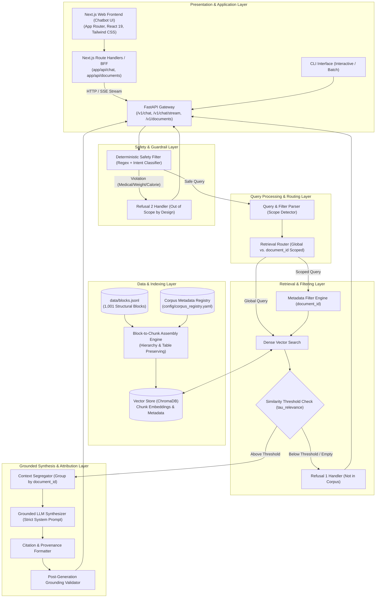
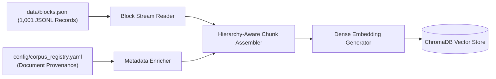
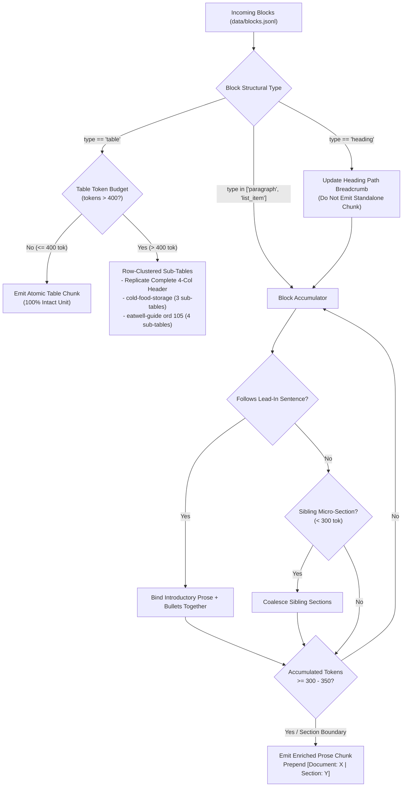
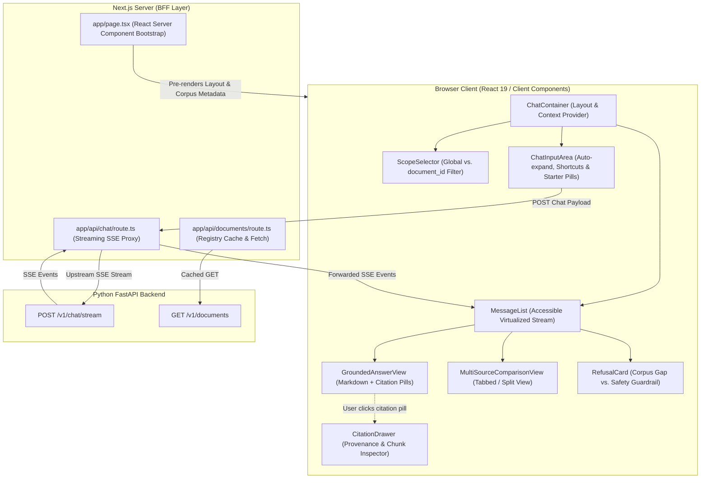
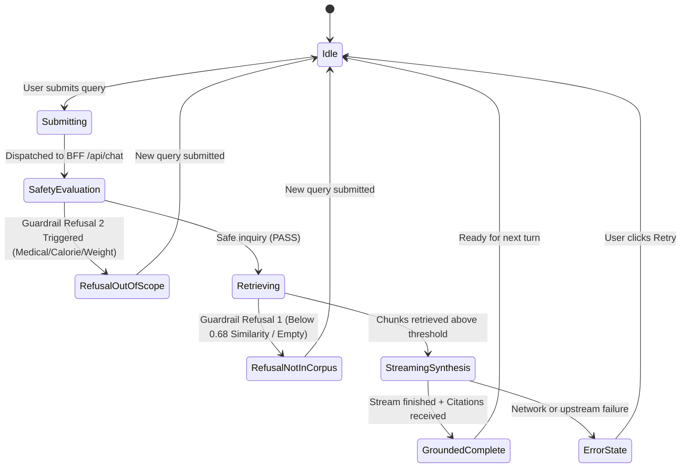
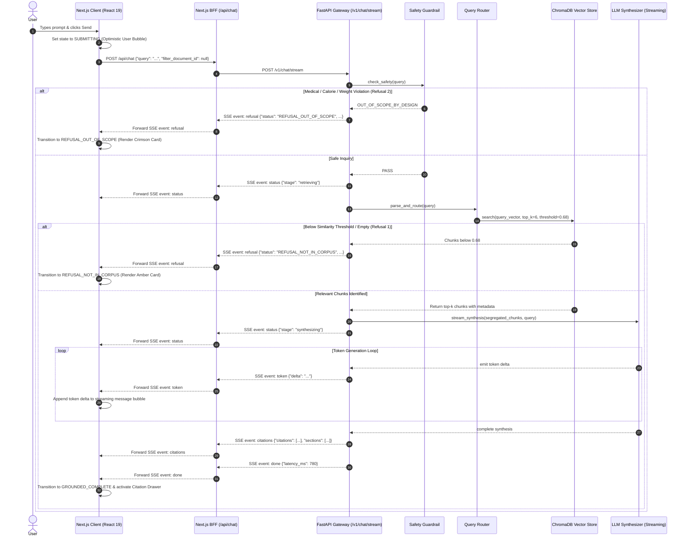
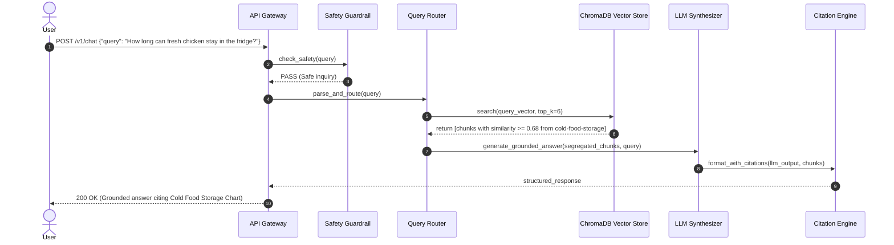
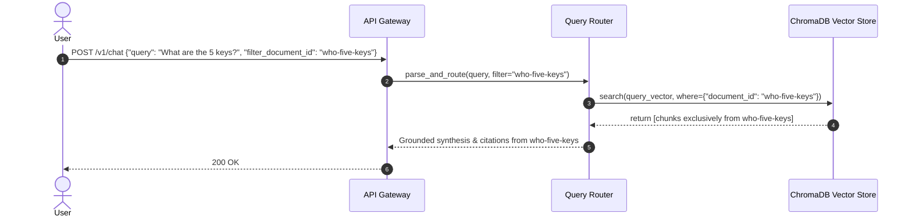
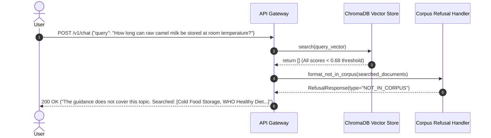
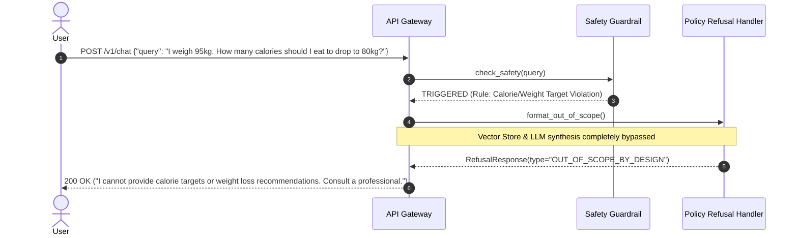

# System Architecture: Dietary Guidance RAG Chatbot

## 1. Executive Summary & Design Philosophy

The **Dietary Guidance RAG Chatbot** is a specialized, evidence-grounded conversational service designed to translate dense, authoritative public health and food safety publications into accessible, factual answers for everyday users.

### 1.1 Core Architectural Principles
1. **Local Pre-Parsed Blocks as Canonical Ground Truth**: The system operates directly on `data/blocks.jsonl`—a curated, locally stored dataset of 1,001 canonical structural blocks (headings, paragraphs, list items, and tables) across 7 recognized guidance publications. No live external web scraping or PDF parsing is performed.
2. **Deterministic Guardrails First**: Safety-critical boundaries (refusing medical advice, calorie prescriptions, and weight targets) are enforced programmatically *before* vector search or LLM generation.
3. **Strict Provenance & Zero Hallucination**: The generation layer operates purely as a deterministic synthesizer of retrieved chunks. If evidence is absent, the system refuses rather than extrapolates.
4. **Isolated Multi-Source Synthesis**: In cross-document inquiries, evidence is segmented and presented per authority. Blending disparate agency guidelines into generic consensus claims is strictly forbidden.
5. **Transparent Information Gaps**: When the corpus lacks relevant guidance, the system explicitly declares the absence and enumerates the specific documents queried.
6. **Block-Aware Structural Preservation**: Chunking groups blocks by document hierarchy (`heading_path`) while preserving `table` blocks in their entirety without destructive mid-cell or mid-row truncation.

---

## 2. End-to-End System Architecture



---

## 3. Data Ingestion & Preprocessing Pipeline (Offline Phase)

Unlike systems that rely on unpredictable live scraping or fragile raw PDF parsing, this architecture ingests a curated, pre-parsed blocks dataset located at `data/blocks.jsonl`.



### 3.1 Corpus Document Registry
The dataset in `data/blocks.jsonl` contains blocks from **7 official publications**. The companion registry (`config/corpus_registry.yaml`) provides authoritative provenance for citations:

```yaml
documents:
  cold-food-storage:
    title: "Cold Food Storage Chart"
    publisher: "U.S. Food and Drug Administration / FoodSafety.gov"
    year: 2021
    category: "food_safety"
    source_url: "https://www.foodsafety.gov/keep-food-safe/cold-food-storage-chart"
    description: "Refrigerator and freezer storage duration limits for meats, poultry, seafood, eggs, and leftovers at 40°F (4°C) or below."

  who-healthy-diet:
    title: "Healthy Diet Fact Sheet N°394"
    publisher: "World Health Organization (WHO)"
    year: 2020
    category: "nutrition"
    source_url: "https://www.who.int/news-room/fact-sheets/detail/healthy-diet"
    description: "Core global principles of healthy diets for adults and infants, addressing fat limits, sugar, salt, fruits, and vegetables."

  fao-who-healthy-diets:
    title: "Sustainable Healthy Diets: Guiding Principles"
    publisher: "Food and Agriculture Organization (FAO) & World Health Organization (WHO)"
    year: 2019
    category: "nutrition"
    source_url: "https://www.fao.org/documents/card/en/c/ca6640en/"
    description: "Guiding principles combining nutritional adequacy and environmental sustainability in dietary habits."

  who-five-keys:
    title: "Five Keys to Safer Food Manual"
    publisher: "World Health Organization (WHO)"
    year: 2006
    category: "food_safety"
    source_url: "https://www.who.int/publications/i/item/9789241594639"
    description: "Core food hygiene manual: Keep clean, separate raw and cooked, cook thoroughly, keep food at safe temperatures, use safe water and raw materials."

  eatwell-guide:
    title: "The Eatwell Guide: Helping you eat a healthy, balanced diet"
    publisher: "Public Health England / NHS / UK Food Standards Agency"
    year: 2018
    category: "nutrition"
    source_url: "https://www.gov.uk/government/publications/the-eatwell-guide"
    description: "UK national food guide outlining dietary proportions across five main food groups, hydration, and nutritional labeling."

  fsa-chill:
    title: "Chilling Food Correctly"
    publisher: "UK Food Standards Agency (FSA)"
    year: 2020
    category: "food_safety"
    source_url: "https://www.food.gov.uk/safety-hygiene/chilling"
    description: "Guidance on refrigerator temperatures (below 5°C), chilling cooked food, freezing, and safe defrosting."

  kitchen-companion:
    title: "Kitchen Companion: Your Safe Food Handbook"
    publisher: "USDA Food Safety and Inspection Service (FSIS)"
    year: 2008
    category: "food_safety"
    source_url: "https://www.fsis.usda.gov/shared/data/Kitchen_Companion.pdf"
    description: "Comprehensive consumer safe food handling handbook covering bacteria, shopping, cooking internal temperatures, and leftovers."
```

### 3.2 Block Schema Specification (`data/blocks.jsonl`)
Every line in `data/blocks.jsonl` is a self-contained JSON record conforming to the following schema:

```json
{
  "document_id": "cold-food-storage",
  "ordinal": 2,
  "type": "table",
  "text": "| Food | Type | Refrigerator [40°F (4°C) or below] | Freezer [0°F (-18°C) or below] |\n| --- | --- | --- | --- |\n| Salad | Egg, chicken, ham, tuna, and macaroni salads | 3 to 4 days | Does not freeze well |\n| Fresh poultry | Chicken or turkey, whole | 1 to 2 days | 1 year |",
  "heading_path": ["Cold Food Storage Chart"],
  "header": ["Food", "Type", "Refrigerator [40°F (4°C) or below]", "Freezer [0°F (-18°C) or below]"],
  "rows": [
    ["Salad", "Egg, chicken, ham, tuna, and macaroni salads", "3 to 4 days", "Does not freeze well"],
    ["Fresh poultry", "Chicken or turkey, whole", "1 to 2 days", "1 year"]
  ],
  "page": 1,
  "level": 1
}
```

#### Field Definitions:
- `document_id` (str): Identifier matching one of the 7 registered documents.
- `ordinal` (int): Sequential zero-indexed position of the block within the document.
- `type` (enum): Block structural category:
  - `"heading"`: Section header, accompanied by `level` (int) and `heading_path` (list).
  - `"paragraph"`: Narrative prose block.
  - `"list_item"`: Bulleted recommendation or guideline item.
  - `"table"`: Tabular data with markdown `text`, column `header` list, and 2D `rows` array.
- `heading_path` (List[str]): Breadcrumb list representing document section hierarchy (e.g., `["Healthy diet", "KEY FACTS"]`).
- `page` (Optional[int]): Page number in original publication (if applicable).
- `level` (Optional[int]): Heading level depth (1 through 4) for `heading` blocks.
- `text` (str): Raw formatted text content of the block (markdown table format for tables).

### 3.3 Data-Calibrated Block-to-Chunk Assembly Engine

Rather than naive fixed-token slicing or generic text splitting, the system deploys a **Data-Calibrated Hierarchy & Table Assembly Engine** directly informed by the structural profile of the 1,001 canonical blocks in `data/blocks.jsonl`.

#### 3.3.1 Empirical Corpus Distribution (`data/blocks.jsonl`)
Structural audit of `data/blocks.jsonl` demonstrates marked variations across the 7 authoritative publications:

| Document ID | Total Blocks | Headings | Paragraphs | List Items | Tables | Architectural Implications |
|---|---|---|---|---|---|---|
| `kitchen-companion` | 469 | 96 | 126 | 239 | 8 | Highly granular hierarchy (depth up to 4); 95 section transitions; 8 atomic tables. |
| `who-five-keys` | 174 | 34 | 38 | 102 | 0 | 102 bullet points in structured hygiene key lists; requires list-intro binding. |
| `eatwell-guide` | 120 | 18 | 59 | 40 | 3 | 2 atomic tables + 1 mega-table (ordinal 105: 6 rows, 5,081 chars). |
| `fao-who-healthy-diets` | 98 | 12 | 72 | 14 | 0 | Dense narrative principles with clear heading hierarchy. |
| `who-healthy-diet` | 92 | 12 | 45 | 35 | 0 | Fact sheet with key bulleted dietary thresholds (sugar, salt, fats). |
| `fsa-chill` | 45 | 4 | 41 | 0 | 0 | Continuous narrative food refrigeration guidelines. |
| `cold-food-storage` | 3 | 1 | 1 | 0 | 1 | 1 heading, 1 lead paragraph, and 1 mega-table (ordinal 2: 53 rows, 4,557 chars). |
| **Corpus Total** | **1,001** | **176** | **383** | **430** | **12** | **43% list items, 12 tables, 170 unique heading paths.** |

- **Structural Block Characteristics**:
  - `heading` (176 blocks): Average length 24.4 chars. Act as hierarchy anchors and are never emitted as standalone chunks.
  - `paragraph` (383 blocks): Average length 215.2 chars (range 7–1,107 chars).
  - `list_item` (430 blocks): Average length 142.1 chars across 108 runs. Account for 43% of the dataset; must remain bound to parent lead-in paragraphs.
  - `table` (12 blocks): Average length 1,607.0 chars (range 246–5,081 chars).

#### 3.3.2 Chunk Assembly Flowchart



#### 3.3.3 Core Assembly & Preservation Rules:

1. **Embedding Window Calibration (`all-MiniLM-L6-v2` & Gemini Compatibility)**:
   - Embedding models like `all-MiniLM-L6-v2` possess an effective sequence limit of **256 WordPiece tokens** (truncated at 512). Chunks exceeding 500 tokens suffer silent tail truncation during embedding generation, dropping critical information.
   - Calibrated target parameters:
     - `target_chunk_tokens`: **300 – 350 tokens** (~1,100 – 1,350 characters).
     - `max_chunk_tokens`: **450 tokens** (hard ceiling 500 tokens).
     - `overlap_blocks`: **1 block** (~30–50 tokens) between consecutive narrative chunks.
2. **Empirical Table Chunking & Preservation Protocol (The 12 Real Tables)**:
   - **Category A: Atomic Tables ($\le 400$ tokens, 10 of 12 tables)**:
     - Kept 100% intact as standalone single-block table chunks without row or cell splitting:
       - `kitchen-companion`: ordinals 92 (17 rows, ~390 tok), 178 (6 rows, ~132 tok), 214 (8 rows, ~380 tok), 216 (11 rows, ~641 tok - split into 2 row chunks), 232 (4 rows, ~113 tok), 252 (7 rows, ~181 tok), 254 (5 rows, ~318 tok), 285 (15 rows, ~358 tok).
       - `eatwell-guide`: ordinals 71 (3 rows, ~70 tok), 81 (11 rows, ~170 tok).
   - **Category B: Segmented Mega-Tables ($> 1,000$ tokens, 2 of 12 tables)**:
     - `cold-food-storage` ordinal 2 (53 rows, 4,557 chars, ~1,300 tokens):
       - If emitted as 1 chunk, queries for "fresh poultry", "eggs", or "leftovers" suffer vector truncation and semantic dilution.
       - **Strategy**: Segmented into 3 logical row clusters (~16–20 rows each, ~370–460 tokens), replicating the complete 4-column header:
         `| Food | Type | Refrigerator [40°F (4°C) or below] | Freezer [0°F (-18°C) or below] |`
         `| --- | --- | --- | --- |`
         across all 3 chunks:
         - *Segment 1 (rows 0–19)*: Salads, Hot dogs, Luncheon meat, Bacon, Sausages, Hamburger, Steaks, Chops, Roasts.
         - *Segment 2 (rows 20–36)*: Ham varieties, Fresh poultry (whole/pieces), Fin fish (fatty/lean).
         - *Segment 3 (rows 37–52)*: Shellfish, Eggs (raw/cooked), Soups, Stews, Leftovers (poultry/pizza).
     - `eatwell-guide` ordinal 105 (6 rows, 5,081 chars, ~1,450 tokens):
       - Each row contains an entire multi-paragraph food group description inside `What’s included?` and `Tips`.
       - **Strategy**: Segmented into 4 chunks (1–2 food groups per chunk, ~270–410 tokens), replicating the complete 4-column header:
         `| Food group | What’s included? | How much? | Tips |`
     - **Structural Invariant**: Slicing **never** bisects a table cell or splits midway through a row. All resulting sub-table chunks preserve 100% of table columns and valid markdown syntax.
3. **List Item & Lead-In Paragraph Binding (430 List Items)**:
   - 430 list items across 108 runs account for 43% of all blocks.
   - Lead-in sentences (e.g., ordinal 14 in `who-healthy-diet`: *"A healthy diet includes the following:"*) must **never** be severed from their subsequent bullet points into an isolated chunk.
   - The chunker groups lead-in sentences and their associated list items into cohesive chunks. If a bulleted list exceeds 450 tokens, it splits strictly at list item boundaries, carrying forward the parent heading path as context.
   - Headings (avg 24 chars) are metadata anchors and are never emitted as standalone chunks.
4. **Hierarchical Breadcrumb Context Injection**:
   - To ensure dense vectors capture hierarchical provenance, the indexed content string is formatted as:
     ```text
     [Document: {document_name} | Section: {' > '.join(heading_path)}]

     {chunk_content}
     ```
   - This ensures isolated bullet points (e.g., *"Less than 10% of total energy intake from free sugars"*) carry the semantic representation of `Healthy diet > FOR ADULTS`.
5. **Micro-Section Coalescing for Deep Hierarchies (`kitchen-companion`)**:
   - `kitchen-companion` contains 95 section transitions with heading depths up to 4. Several sub-sections contain only 1–2 short paragraphs (< 80 tokens).
   - Rather than generating fragmented micro-chunks that produce high cosine variance, the chunker coalesces adjacent sibling sections sharing the same parent hierarchy until reaching `target_chunk_tokens` (~350 tokens).
6. **Metadata Inheritance**:
   - Every generated chunk inherits:
     - `document_id`: Canonical document identifier.
     - `document_name`: Authoritative title from registry.
     - `publisher`: Responsible agency/organization.
     - `year`: Publication year.
     - `section_heading`: Joined `heading_path` breadcrumb string.
     - `source_url`: Verifiable deep URL.
     - `ordinal_range`: `[min_ordinal, max_ordinal]` of source blocks included.
     - `page_range`: `[min_page, max_page]` where available.

---

## 4. Online Execution Pipeline & Runtime Components

### 4.1 Step 1: Deterministic Safety Guardrail (Refusal 2)
Before generating embeddings or querying the vector store, all queries pass through the **Safety Guardrail Engine**.

#### Policy Boundaries:
1. **Medical Diagnosis & Disease Treatment**: Requests on managing medical conditions (e.g., diabetes diets, hypertension management, Crohn's disease diets).
2. **Personalized Caloric Targets**: Queries requesting specific daily calorie targets (e.g., *"How many calories should I eat to lose 10 pounds?"*).
3. **Target Body Weight & BMI Prescriptions**: Questions asking what the user should weigh or how to reach a target weight.

#### Implementation:
- **Enforcement Mechanism**: Deterministic rule matcher combining keyword regex patterns with a lightweight zero-shot classifier.
- **Execution**: If triggered, execution halts immediately with `RefusalResponse(type="OUT_OF_SCOPE_BY_DESIGN")`.

```python
# Conceptual Safety Guardrail Logic
MEDICAL_WEIGHT_PATTERNS = [
    r"\b(lose|drop|burn)\s+\d+\s*(kg|lbs?|pounds?|kilos?)\b",
    r"\bhow\s+many\s+calories\s+(should|can)\s+i\s+(eat|consume)\b",
    r"\bwhat\s+should\s+i\s+weigh\b",
    r"\b(cure|treat|reverse|manage)\s+(diabetes|cancer|hypertension|crohn|celiac)\b",
    r"\bmy\s+bmi\s+is\b",
]

def evaluate_safety_guardrail(query: str) -> Optional[ChatResponse]:
    for pattern in MEDICAL_WEIGHT_PATTERNS:
        if re.search(pattern, query, re.IGNORECASE):
            return ChatResponse(
                status="REFUSAL_OUT_OF_SCOPE",
                query=query,
                response_text=(
                    "I cannot provide medical advice, specific calorie targets, "
                    "or body weight recommendations. For personalized clinical or "
                    "weight-related guidance, please consult a registered dietitian "
                    "or qualified healthcare professional."
                )
            )
    return None
```

### 4.2 Step 2: Query Parsing & Filter Routing
The query router inspects the user query or explicit parameters for document scoping:
- **Explicit Scoping**: If the user specifies a document filter (e.g., via dropdown or parameter `filter_document_id="kitchen-companion"`), the retriever applies a metadata pre-filter:
  `filter_condition = {"document_id": {"$eq": filter_document_id}}`
- **Global Inquiries**: If no filter is specified, search executes across the entire vector index.

### 4.3 Step 3: Dual-Mode Vector Retrieval & Threshold Evaluation (Refusal 1)
- **Dense Embedding Model**: Fast semantic embedding model (e.g., `all-MiniLM-L6-v2` or `text-embedding-3-small`).
- **Retrieval Parameters**: `top_k = 6`, similarity threshold $\tau_{relevance} = 0.68$.
- **Corpus Gap Detection (Refusal 1)**:
  - If no chunks meet the threshold ($\max(\text{scores}) < \tau_{relevance}$), the query is flagged as unanswerable from the guidance documents.
  - The system enumerates all registered guidance documents searched and returns `RefusalResponse(type="NOT_IN_CORPUS")`.

```python
# Conceptual Retrieval Threshold Evaluation
if not retrieved_chunks or max_similarity < RELEVANCE_THRESHOLD:
    searched_docs = [
        f"{meta['title']} ({meta['publisher']}, {meta['year']})"
        for meta in corpus_registry.values()
    ]
    return ChatResponse(
        status="REFUSAL_NOT_IN_CORPUS",
        query=query,
        response_text=(
            "The official guidance documents in our corpus do not address this question. "
            "Searched sources:\n- " + "\n- ".join(searched_docs)
        ),
        searched_documents=list(corpus_registry.keys())
    )
```

### 4.4 Step 4: Cross-Document Segregation & Context Isolation
When retrieved chunks originate from multiple documents (e.g., cooking oils or food storage temperatures):
- **Chunks are segregated by `document_id`** before prompting the LLM.
- Chunks from different publishers are never aggregated into an unlabelled monolithic text block.

```markdown
[SOURCE 1: Healthy Diet Fact Sheet N°394 | WHO, 2020 | https://www.who.int/...]
<Chunks from WHO regarding fat intake: total fat <30%, saturated fat <10%>

[SOURCE 2: The Eatwell Guide | Public Health England / NHS, 2018 | https://www.gov.uk/...]
<Chunks from Eatwell Guide regarding choosing unsaturated oils and spreads in small amounts>
```

### 4.5 Step 5: Grounded Synthesis & Citation Attribution Engine
The LLM synthesizer generates the final response subject to strict negative constraints:

#### System Prompt Template:
```text
You are an authoritative Dietary and Food Safety Guidance Assistant.
Your answers are STRICTLY grounded in the provided context excerpts.

RULES:
1. Grounding: Answer ONLY based on the provided context chunks. NEVER use external or parametric knowledge.
2. Citation Requirement: Every recommendation or factual claim MUST include an exact inline citation:
   [Document Title | Publisher, Year | Source URL]
3. Multi-Document Structure: If multiple sources are provided, structure your answer into separate sections per source. NEVER combine statements from different publishers into a blended claim like "The guidelines recommend...".
4. Negative Constraint: Do not give personalized medical advice, calorie targets, or weight management goals.
5. Missing Details: If the context only partially covers the question, state clearly what is known and what is missing.
```

### 4.6 Step 6: Real-Time Token Streaming & Server-Sent Events (SSE)
To minimize time-to-first-token (TTFT) and provide a responsive conversational experience, the system implements an asynchronous Server-Sent Events (SSE) protocol on `/v1/chat/stream`:

1. **Protocol Transport**: Textual event stream (`Content-Type: text/event-stream; charset=utf-8`) conforming to the W3C EventSource standard.
2. **Event Types**:
   - `event: status`: Pipeline lifecycle updates (`{"stage": "safety_check" | "retrieving" | "synthesizing"}`).
   - `event: token`: Incremental synthesis token delta (`{"delta": str}`).
   - `event: citations`: Complete structured citation list emitted immediately upon synthesis completion (`{"citations": List[Citation], "sections": List[GroundedSection]}`).
   - `event: refusal`: Structured refusal payload emitted if guardrails or similarity thresholds trip (`{"status": "REFUSAL_NOT_IN_CORPUS" | "REFUSAL_OUT_OF_SCOPE", "message": str, "searched_documents": List[str]}`).
   - `event: done`: Execution telemetry including generation latency and chunk count (`{"latency_ms": int, "chunks_retrieved": int}`).
   - `event: error`: Unhandled runtime exceptions formatted for safe client consumption.

---

## 5. Front-End Chatbot Architecture & Next.js Model

The front-end is designed as a modern, accessible, evidence-transparent conversational application built with **Next.js 15 (App Router)**, **React 19**, **TypeScript**, and **Tailwind CSS**. Its primary design imperative is **Verifiable Provenance**: claims, citations, and guidance boundaries are given first-class interactive visual prominence rather than buried in raw prose.



### 5.1 Next.js App Router Architecture & BFF Pattern
The application leverages the Next.js App Router (`frontend/src/app`) to separate server-side data fetching from rich client interactions:

1. **React Server Components (RSC) for Bootstrap**:
   - `app/layout.tsx` and `app/page.tsx` execute server-side to fetch authoritative corpus metadata from `/v1/documents`.
   - The initial HTML payload includes pre-rendered corpus registries, system descriptions, SEO metadata, and accessibility headers, ensuring near-instant Initial Server Response (TTFB).
2. **Backend-for-Frontend (BFF) Route Handlers**:
   - `app/api/chat/route.ts` acts as a secure, edge-compatible intermediary between the client browser and the FastAPI backend.
   - **Responsibilities**:
     - Strips and validates user inputs using Zod schemas.
     - Eliminates client-side Cross-Origin Resource Sharing (CORS) complications.
     - Proxies the `POST /v1/chat/stream` response as a streaming `ReadableStream`, handling backpressure and propagating upstream network disconnects.
     - Protects internal network topologies and API keys.

### 5.2 Client-Side Chatbot State Machine & Hook Lifecycle
The conversation lifecycle is governed by an explicit Finite State Machine (FSM) implemented in the `useChatbot` custom hook.



#### State Definitions & UI Behaviors:
- **`Idle`**: Input field enabled. Starter query suggestions visible when message history is empty. Scope selector interactive.
- **`Submitting`**: Optimistic user message added to thread. Input temporarily locked. Abort controller initialized.
- **`SafetyEvaluation` / `Retrieving`**: Visual skeleton pulsing indicator with phase status badge (*"Evaluating official safety parameters..."* or *"Searching 7 guidance publications..."*).
- **`StreamingSynthesis`**: Incremental token appending via React 19 concurrent transitions. Inline markdown renderer parses headers, lists, and markdown tables with a smooth streaming cursor. Stop button enabled.
- **`GroundedComplete`**: Stream finalized. Inline citation badges highlighted and interactive. Provenance drawer synchronized.
- **`RefusalNotInCorpus`**: Amber alert card rendered with an itemized, interactive list of all 7 queried guidance publications.
- **`RefusalOutOfScope`**: Crimson policy card rendered with clinical disclaimer and explicit recommendation to consult healthcare professionals.
- **`ErrorState`**: Toast alert and inline message error card with one-click retry trigger.

### 5.3 UI Component Model & Visual Hierarchy

#### 1. ScopeSelector Component (`ScopeSelector.tsx`)
- Allows the user to toggle between aggregate corpus retrieval (**"All 7 Guidance Documents"**) and single-document filtered inquiries (**"Cold Food Storage Chart"**, **"WHO Healthy Diet"**, etc.).
- Renders as a modern horizontal pill bar on desktop and an accessible dropdown menu on mobile.
- Shows publisher badges (e.g., `FDA`, `WHO`, `USDA`, `UK FSA`) and publication years.

#### 2. MessageList & MessageItem Components
- Virtualized message stream ensuring frictionless 60 FPS scrolling during heavy token streaming.
- Markdown rendering powered by `react-markdown` with `remark-gfm` for tables and lists.
- Integrated clipboard copy for answers and citation references.

#### 3. GroundedAnswerView & Inline Citation Badges
- Replaces raw citation text with interactive inline citation pills:
  `[Cold Food Storage Chart | FDA/FoodSafety.gov, 2021]`
- Hovering displays a tooltip preview with the publication title and publisher.
- Clicking dispatches an event to the global UI context to slide open the **CitationDrawer** focused on that specific source.

#### 4. MultiSourceComparisonView
- When an inquiry retrieves evidence from multiple publishers (e.g., WHO guidelines vs. UK Eatwell Guide on fat or oil intake), synthesis is presented in a **segmented multi-card layout** or **tabbed side-by-side view**.
- Strictly prevents cognitive blending of distinct agency recommendations. Each card displays its own publisher emblem, publication date, and section breadcrumbs.

#### 5. CitationDrawer Component (`CitationDrawer.tsx`)
- A slide-over flyout panel (or bottom sheet on mobile) displaying complete provenance for every retrieved chunk:
  - **Publication Title & Publisher**: Official badge and logo.
  - **Publication Year & Category**: Tagged as `Food Safety` or `Dietary Nutrition`.
  - **Hierarchy Breadcrumb**: `heading_path` list (e.g., `Cold Food Storage Chart > Fresh poultry`).
  - **Verbatim Excerpt**: Exact chunk content extracted from `data/blocks.jsonl`.
  - **Relevance Metrics**: Cosine similarity score ($\ge 0.68$) and source block ordinal index.
  - **Official Verification Link**: Deep link to canonical external URL (e.g., `https://www.foodsafety.gov/...`).

#### 6. RefusalCard Component (`RefusalCard.tsx`)
- Dedicated visual treatments to avoid confusing system failures with intentional guardrail enforcement:
  - **Type 1 (Information Gap / Not in Corpus)**:
    - Ambient theme: Amber border and soft yellow background.
    - Message: *"The official dietary and food safety documents in our corpus do not contain verified guidance on this topic."*
    - Interactive Pill Grid: Displays all 7 searched documents with click-to-view metadata.
  - **Type 2 (Policy / Safety Boundary)**:
    - Ambient theme: Rose/crimson border with safety shield icon.
    - Message: *"I cannot provide personalized calorie targets, medical nutrition advice, or body weight prescriptions."*
    - Educational Callout: Clear explanation of safety boundaries with guidance to consult a registered dietitian (RD) or primary care physician.

#### 7. ChatInputArea Component (`ChatInputArea.tsx`)
- Auto-expanding textarea with keyboard shortcuts (`Enter` to submit, `Shift + Enter` for line breaks).
- Character counter and maximum length validator (500 characters).
- Suggestion chips for representative starter prompts:
  - *"How long can cooked chicken stay in the fridge?"*
  - *"What are the WHO daily free sugar recommendations?"*
  - *"What temperature should leftovers be reheated to?"*
  - *"What are the Five Keys to Safer Food?"*

### 5.4 Real-Time Streaming SSE Protocol (Client-Side)
The Next.js client consumes SSE streams via the native Web Fetch API and `ReadableStreamDefaultReader`:

```typescript
// Conceptual SSE Consumer in useChatbot Hook
const response = await fetch('/api/chat', {
  method: 'POST',
  headers: { 'Content-Type': 'application/json' },
  body: JSON.stringify({ query, filterDocumentId: activeFilter }),
  signal: abortController.signal
});

const reader = response.body?.getReader();
const decoder = new TextDecoder();

while (reader) {
  const { done, value } = await reader.read();
  if (done) break;

  const chunk = decoder.decode(value, { stream: true });
  // Parse SSE format: event: <type>\ndata: <json>\n\n
  processSSEChunk(chunk);
}
```

### 5.5 Accessibility (a11y) & Usability Standards
1. **Screen Reader Announcements**: Streaming assistant output is wrapped in an `aria-live="polite"` container, ensuring real-time accessibility without interrupting active speech synthesizers.
2. **Keyboard Navigation & Focus Management**:
   - Citation pills are focusable buttons (`tabindex="0"`) with clear focus rings.
   - The Citation Drawer implements an accessible focus trap with `Escape` key close handlers (via Radix UI Dialog / Sheet).
3. **WCAG 2.1 AA Color Contrast**: All amber and rose refusal cards maintain a minimum 4.5:1 text-to-background contrast ratio in both Light and Dark display modes.

---

## 6. Sequence Workflows

### 6.1 Next.js Real-Time Streaming Chat Flow (SSE)


### 6.2 Standard Grounded Query (Happy Path REST)


### 6.3 Document-Filtered Query


### 6.4 Refusal Flow 1: Information Gap (Not in Corpus)


### 6.5 Refusal Flow 2: Medical / Calorie Guardrail (Out of Scope by Design)


---

## 7. Detailed Module & Data Contracts

### 7.1 Python Backend Schemas (`src/models/schemas.py`)

```python
from pydantic import BaseModel, Field
from typing import List, Optional, Literal, Tuple, Any

class BlockRecord(BaseModel):
    """Schema matching records in data/blocks.jsonl"""
    document_id: str
    ordinal: int
    type: Literal["heading", "paragraph", "list_item", "table"]
    text: str
    heading_path: List[str]
    page: Optional[int] = None
    level: Optional[int] = None
    header: Optional[List[str]] = None
    rows: Optional[List[List[str]]] = None
    caption: Optional[str] = None

class DocumentMetadata(BaseModel):
    document_id: str
    title: str
    publisher: str
    year: int
    category: Literal["nutrition", "food_safety"]
    source_url: str
    description: str

class Chunk(BaseModel):
    chunk_id: str
    document_id: str
    document_name: str
    publisher: str
    year: int
    section_heading: str
    source_url: str
    content: str
    block_ordinals: List[int]
    page_numbers: List[int]
    similarity_score: Optional[float] = None

class ChatRequest(BaseModel):
    query: str
    filter_document_id: Optional[str] = None

class Citation(BaseModel):
    document_name: str
    publisher: str
    year: int
    source_url: str
    section_heading: str
    chunk_id: Optional[str] = None
    verbatim_text: Optional[str] = None
    similarity_score: Optional[float] = None

class GroundedSection(BaseModel):
    document_name: str
    publisher: str
    year: int
    source_url: str
    summary_text: str
    citations: List[Citation] = []

class ChatResponse(BaseModel):
    status: Literal["SUCCESS", "REFUSAL_NOT_IN_CORPUS", "REFUSAL_OUT_OF_SCOPE"]
    query: str
    response_text: str
    sections: List[GroundedSection] = []
    citations: List[Citation] = []
    searched_documents: List[str] = []
    latency_ms: Optional[int] = None
```

### 7.2 TypeScript Frontend Data Contracts (`frontend/src/types/chat.ts`)

```typescript
/**
 * Frontend TypeScript Data Models matching FastAPI and SSE Stream specifications
 */

export type DocumentCategory = 'nutrition' | 'food_safety';

export interface CorpusDocument {
  documentId: string;
  title: string;
  publisher: string;
  year: number;
  category: DocumentCategory;
  sourceUrl: string;
  description: string;
}

export interface CitationItem {
  citationId: string;
  documentName: string;
  publisher: string;
  year: number;
  sourceUrl: string;
  sectionHeading: string;
  chunkId?: string;
  verbatimText?: string;
  similarityScore?: number;
}

export interface GroundedSectionItem {
  documentName: string;
  publisher: string;
  year: number;
  sourceUrl: string;
  summaryText: string;
  citations: CitationItem[];
}

export type MessageRole = 'user' | 'assistant' | 'system';

export type ChatTurnStatus =
  | 'IDLE'
  | 'SUBMITTING'
  | 'EVALUATING_SAFETY'
  | 'RETRIEVING'
  | 'STREAMING'
  | 'SUCCESS'
  | 'REFUSAL_NOT_IN_CORPUS'
  | 'REFUSAL_OUT_OF_SCOPE'
  | 'ERROR';

export interface RefusalPayload {
  type: 'NOT_IN_CORPUS' | 'OUT_OF_SCOPE_BY_DESIGN';
  message: string;
  searchedDocuments?: string[];
  suggestedAction?: string;
}

export interface ChatMessage {
  id: string;
  role: MessageRole;
  content: string;
  status: ChatTurnStatus;
  timestamp: number;
  filterDocumentId?: string | null;
  sections?: GroundedSectionItem[];
  citations?: CitationItem[];
  refusal?: RefusalPayload;
  latencyMs?: number;
}

export interface ChatRequestPayload {
  query: string;
  filterDocumentId?: string | null;
}

// SSE Protocol Event Shapes
export type SSEEvent =
  | { event: 'status'; data: { stage: 'safety_check' | 'retrieving' | 'synthesizing' } }
  | { event: 'token'; data: { delta: string } }
  | { event: 'citations'; data: { citations: CitationItem[]; sections: GroundedSectionItem[] } }
  | { event: 'refusal'; data: RefusalPayload }
  | { event: 'done'; data: { latencyMs: number; chunksRetrieved: number } }
  | { event: 'error'; data: { message: string; code?: string } };
```

### 7.3 Next.js BFF Route Handler (`frontend/src/app/api/chat/route.ts`)

```typescript
import { NextRequest, NextResponse } from 'next/server';

export const runtime = 'nodejs'; // or 'edge'
export const dynamic = 'force-dynamic';

export async function POST(req: NextRequest) {
  try {
    const body = await req.json();
    const { query, filterDocumentId } = body;

    if (!query || typeof query !== 'string') {
      return NextResponse.json({ error: 'Query is required' }, { status: 400 });
    }

    const backendUrl = process.env.FASTAPI_BACKEND_URL || 'http://127.0.0.1:8000';
    const upstreamRes = await fetch(`${backendUrl}/v1/chat/stream`, {
      method: 'POST',
      headers: { 'Content-Type': 'application/json' },
      body: JSON.stringify({
        query: query.trim(),
        filter_document_id: filterDocumentId || null,
      }),
    });

    if (!upstreamRes.ok) {
      const errorText = await upstreamRes.text();
      return NextResponse.json(
        { error: `Upstream error: ${errorText}` },
        { status: upstreamRes.status }
      );
    }

    // Stream the SSE body directly to the client browser
    return new Response(upstreamRes.body, {
      headers: {
        'Content-Type': 'text/event-stream; charset=utf-8',
        'Cache-Control': 'no-cache, no-transform',
        'Connection': 'keep-alive',
      },
    });
  } catch (error: any) {
    return NextResponse.json(
      { error: error?.message || 'Internal BFF Gateway Error' },
      { status: 500 }
    );
  }
}
```

---

## 8. Technology Stack & Component Selection

| Component | Selected Technology | Alternative Considered | Rationale |
|---|---|---|---|
| **Data Source** | Local `data/blocks.jsonl` | Web scraping, live PDF parsing | Eliminates network latency, parsing flakiness, and legal/scraping rate limits. Guaranteed reproducibility with 1,001 canonical pre-parsed blocks. |
| **Vector Database** | `ChromaDB` (Embedded) | `FAISS`, `Qdrant` | Lightweight, native metadata filtering on `document_id`, local persistent storage, zero Docker setup required. |
| **Embedding Model** | `all-MiniLM-L6-v2` or `text-embedding-3-small` | `bge-large-en` | Fast local inference, robust semantic alignment with public health prose. |
| **LLM Synthesis** | Google Gemini API (`gemini-2.5-flash` / `gemini-1.5-pro`) | Claude 3.5 Sonnet, GPT-4o | Outstanding instruction following for negative constraints, streaming token support, and strict citation formatting. |
| **API Framework** | `FastAPI` + `Pydantic v2` | Flask | Asynchronous, typed endpoints with automatic OpenAPI documentation and native SSE streaming. |
| **User Interface** | **Next.js 15 (App Router) + React 19 + TypeScript + Tailwind CSS** | Streamlit | Production-grade web architecture, sub-second TTFB with React Server Components, real-time SSE streaming, accessible interactive citation flyout drawers, multi-document tabbed comparisons, and responsive desktop/mobile layouts. *(Streamlit retained as optional internal diagnostic tool)*. |
| **UI Primitives & Icons** | `Radix UI` / `shadcn/ui` + `Lucide React` | Material UI, AntD | Unstyled, fully accessible (WCAG 2.1 AA) primitives with minimal bundle footprint and full design customization. |
| **Markdown & Syntax** | `react-markdown` + `remark-gfm` | Draft.js | Lightweight parsing of LLM markdown outputs, tables, and custom inline citation pill tokens. |
| **Testing & Evaluation** | `pytest` + `Ragas` (Backend) / `Vitest` + `Playwright` (Frontend) | TruLens / Cypress | Comprehensive verification across guardrail regexes, chunking integrity, SSE streaming robustness, and WCAG accessibility. |

---

## 9. Repository Directory Layout

```
rag-nutrison/
├── frontend/                               # Next.js 15 Web Application
│   ├── package.json                        # Frontend dependencies (Next.js 15, React 19, Tailwind)
│   ├── tsconfig.json                       # Strict TypeScript configuration
│   ├── tailwind.config.ts                  # Design tokens, color schemes, animations
│   ├── next.config.ts                      # Next.js configuration & environment bindings
│   ├── public/                             # Static assets, agency emblems, favicons
│   └── src/
│       ├── app/
│       │   ├── layout.tsx                  # Root layout: font provider, theme, accessible meta
│       │   ├── page.tsx                    # Main chat interface (RSC bootstrap + corpus fetch)
│       │   ├── globals.css                 # Tailwind directives and CSS variables
│       │   └── api/
│       │       ├── chat/
│       │       │   └── route.ts            # BFF SSE streaming proxy to FastAPI /v1/chat/stream
│       │       └── documents/
│       │           └── route.ts            # Corpus registry metadata proxy & cache
│       ├── components/
│       │   ├── chat/
│       │   │   ├── ChatContainer.tsx       # Main chat orchestrator & conversation context
│       │   │   ├── ChatHeader.tsx          # Top bar, corpus freshness badge, source registry modal
│       │   │   ├── ScopeSelector.tsx       # Interactive document filter pill-bar / select menu
│       │   │   ├── MessageList.tsx         # Accessible virtualized message thread
│       │   │   ├── MessageItem.tsx         # User bubble and Assistant bubble wrappers
│       │   │   ├── GroundedAnswerView.tsx  # Markdown renderer with clickable inline citation pills
│       │   │   ├── MultiSourceView.tsx     # Tabbed / side-by-side view for multi-agency answers
│       │   │   ├── CitationDrawer.tsx      # Slide-over flyout panel for chunk excerpts & links
│       │   │   ├── RefusalCard.tsx         # Distinct amber (gap) & crimson (safety) refusal cards
│       │   │   └── ChatInputArea.tsx       # Textarea, starter suggestion chips, submit/stop controls
│       │   └── ui/                         # shadcn/ui primitives (button, badge, sheet, tooltip)
│       ├── hooks/
│       │   ├── useChatbot.ts               # Core conversational state machine & SSE stream reader
│       │   └── useCorpusRegistry.ts        # Hook fetching and caching the 7 corpus publications
│       ├── lib/
│       │   ├── sse-parser.ts               # EventSource text stream decoder
│       │   └── utils.ts                    # Utility class mergers (clsx, tailwind-merge)
│       └── types/
│           └── chat.ts                     # TypeScript data contracts, message states & SSE types
├── config/
│   ├── corpus_registry.yaml                # Provenance metadata for the 7 documents in blocks.jsonl
│   └── settings.py                         # Environment settings, thresholds, model paths
├── data/
│   ├── blocks.jsonl                        # Canonical source: 1,001 pre-parsed blocks
│   └── vectordb/                           # Local ChromaDB persistent vector storage
├── doc/
│   ├── problemStatement.txt               # Original brief
│   ├── problemStatement.md                # Detailed functional specification
│   └── architecture.md                    # Detailed System Architecture
├── src/                                    # Python Backend & RAG Pipeline
│   ├── __init__.py
│   ├── api/
│   │   ├── __init__.py
│   │   ├── app.py                         # FastAPI gateway application
│   │   └── routes.py                      # /v1/chat, /v1/chat/stream, /v1/documents endpoints
│   ├── guardrails/
│   │   ├── __init__.py
│   │   ├── safety_filter.py               # Medical, calorie & weight loss deterministic block
│   │   └── refusal_handlers.py            # Refusal 1 and Refusal 2 response formatters
│   ├── ingestion/
│   │   ├── __init__.py
│   │   ├── block_reader.py                # Reader for data/blocks.jsonl
│   │   └── block_chunker.py               # Hierarchy and table preserving chunk assembler
│   ├── retrieval/
│   │   ├── __init__.py
│   │   ├── vector_store.py                # ChromaDB client and index builder
│   │   └── retriever.py                   # Global & document_id filtered dense retrieval
│   ├── generation/
│   │   ├── __init__.py
│   │   ├── prompt_templates.py            # Strict grounding & citation prompts
│   │   ├── synthesizer.py                 # LLM synthesizer with multi-document segregation
│   │   └── citation_formatter.py          # Citation verification and syntax formatter
│   ├── models/
│   │   ├── __init__.py
│   │   └── schemas.py                     # Pydantic data schemas (BlockRecord, Chunk, etc.)
│   └── ui/
│       └── app.py                         # Optional internal Streamlit diagnostic UI
├── tests/
│   ├── test_guardrails.py                 # Tests for Refusal 2 (medical/weight/calorie)
│   ├── test_chunking.py                   # Tests for table preservation & heading continuity
│   ├── test_retrieval.py                  # Tests for global vs. filtered retrieval
│   ├── test_synthesis.py                  # Tests for citation formatting & Refusal 1
│   └── test_streaming.py                  # Tests for FastAPI SSE stream outputs
├── architecture.md                         # Root architectural specification
├── problemStatement.md                     # Root problem statement
├── requirements.txt                        # Backend Python dependencies
└── README.md                               # Documentation, chunking trade-offs & startup guide
```
