# Implementation Plan: Dietary Guidance RAG Chatbot

**Document Reference**: `doc/implemenation-phase.md`  
**Related Documents**: [`doc/architecture.md`](file:///C:/Users/HP/workspace/AI_AI_AI/ToDo/rag-nutrison/doc/architecture.md), [`doc/problemStatement.md`](file:///C:/Users/HP/workspace/AI_AI_AI/ToDo/rag-nutrison/doc/problemStatement.md)  
**Corpus Source**: `data/blocks.jsonl` (1,001 canonical structural blocks across 7 authoritative publications)  
**Target Environment**: Python 3.11+ / FastAPI / ChromaDB / Google Gemini API / Next.js 15 (App Router, React 19, TypeScript, Tailwind CSS)

---

## 1. Executive Summary & Implementation Strategy

This implementation plan defines the complete engineering roadmap for building the **Dietary Guidance RAG Chatbot**. The plan translates the requirements from [`doc/problemStatement.md`](file:///C:/Users/HP/workspace/AI_AI_AI/ToDo/rag-nutrison/doc/problemStatement.md) and technical architecture from [`doc/architecture.md`](file:///C:/Users/HP/workspace/AI_AI_AI/ToDo/rag-nutrison/doc/architecture.md) into concrete, sequential, and verifiable milestones.

### 1.1 Core Strategic Constraints
1. **Zero External Data Fetching**: System ingestion operates solely on the local `data/blocks.jsonl` file. No live web scraping, external network requests, or raw PDF parsing are executed during ingestion.
2. **Guaranteed Structural Integrity**: Tabular blocks (`type="table"`) must remain intact without destructive row-level or cell-level token slicing.
3. **Deterministic Guardrails Before Retrieval**: Queries violating safety rules (medical advice, calorie prescriptions, target weights) must be intercepted programmatically prior to vector retrieval or LLM inference.
4. **Calibrated Similarity Cutoff ($\tau_{relevance} = 0.68$)**: Queries lacking sufficient semantic matches trigger an explicit information gap refusal (Refusal 1) that lists all queried documents.
5. **Isolated Attribution & No Agency Blending**: Multi-document responses must segregate evidence under distinct per-authority headings with verifiable citations (`[Document Title | Publisher, Year | Source URL]`).
6. **Real-Time Streaming & Full Provenance UX**: Token streaming via Server-Sent Events (SSE) directly into an accessible Next.js 15 client featuring interactive citation pills and a slide-over provenance drawer.

---

## 2. Master Phase Dependency Graph & Traceability Matrix

### 2.1 Execution Dependency Graph (Mermaid)

```mermaid
flowchart TD
    subgraph Foundation["Phase 0: Environment & Contracts"]
        P0_Env["0.1 Python & Node Setup"]
        P0_Config["0.2 Corpus Registry & Settings"]
        P0_Schemas["0.3 Pydantic Data Contracts"]
        P0_Env --> P0_Config --> P0_Schemas
    end

    subgraph DataPipeline["Phase 1: Ingestion & Assembly"]
        P1_Reader["1.1 Block Stream Reader"]
        P1_Chunker["1.2 Hierarchy & Table Preserving Chunker"]
        P1_Tests["1.3 Chunking Unit Tests"]
        P0_Schemas --> P1_Reader --> P1_Chunker --> P1_Tests
    end

    subgraph IndexRetrieval["Phase 2: Indexing & Retrieval"]
        P2_Vector["2.1 ChromaDB Store Setup"]
        P2_Index["2.2 Offline Ingestion CLI"]
        P2_Retriever["2.3 Dual-Mode Retriever & Thresholding"]
        P2_Tests["2.4 Retrieval Verification Tests"]
        P1_Tests --> P2_Vector --> P2_Index --> P2_Retriever --> P2_Tests
    end

    subgraph Guardrails["Phase 3: Safety Guardrails"]
        P3_Regex["3.1 Deterministic Safety Filter"]
        P3_Handlers["3.2 Refusal 1 & 2 Formatters"]
        P3_Tests["3.3 Guardrail Unit Tests"]
        P0_Schemas --> P3_Regex --> P3_Handlers --> P3_Tests
    end

    subgraph Generation["Phase 4: Synthesis & Provenance"]
        P4_Prompts["4.1 Grounded Prompt Templates"]
        P4_Synthesizer["4.2 Isolated Multi-Doc Synthesizer"]
        P4_Citations["4.3 Citation Formatter & Auditor"]
        P4_Tests["4.4 Synthesis Grounding Tests"]
        P2_Tests --> P4_Prompts
        P3_Tests --> P4_Prompts
        P4_Prompts --> P4_Synthesizer --> P4_Citations --> P4_Tests
    end

    subgraph BackendAPI["Phase 5: FastAPI Gateway & SSE"]
        P5_FastAPI["5.1 FastAPI Application Core"]
        P5_SSE["5.2 Asynchronous SSE Streaming (/v1/chat/stream)"]
        P5_REST["5.3 REST Endpoints (/v1/chat, /v1/documents)"]
        P5_Tests["5.4 API Integration & Streaming Tests"]
        P4_Tests --> P5_FastAPI --> P5_SSE --> P5_REST --> P5_Tests
    end

    subgraph InternalDiagnostics["Phase 6: Diagnostic UI (Optional)"]
        P6_Streamlit["6.1 Streamlit Inspector & Vector Visualizer"]
        P5_Tests --> P6_Streamlit
    end

    subgraph FrontendApp["Phase 7: Next.js 15 Client"]
        P7_Init["7.1 Next.js 15 + Tailwind + Types Setup"]
        P7_BFF["7.2 BFF Route Handlers (SSE Proxy & Cache)"]
        P7_Hooks["7.3 useChatbot State Machine & SSE Reader"]
        P7_UI["7.4 Core UI Components (Drawer, Scope, Refusal)"]
        P7_Tests["7.5 Frontend Component & a11y Tests"]
        P5_Tests --> P7_Init --> P7_BFF --> P7_Hooks --> P7_UI --> P7_Tests
    end

    subgraph Verification["Phase 8: End-to-End Acceptance & Delivery"]
        P8_Acceptance["8.1 Acceptance Criteria Test Suite (6 Scenarios)"]
        P8_Perf["8.2 Latency, TTFT & Memory Benchmark"]
        P8_Docs["8.3 README & Trade-off Documentation"]
        P7_Tests --> P8_Acceptance --> P8_Perf --> P8_Docs
        P6_Streamlit -.-> P8_Acceptance
    end
```



### 2.2 Traceability Matrix

| Problem Statement / Architecture Component | Implementation Phase | Key Code Deliverables | Primary Verification Target |
|---|---|---|---|
| **Corpus Data Source (7 Documents, 1,001 Blocks)** | Phase 0 & Phase 1 | `config/corpus_registry.yaml`, `src/ingestion/block_reader.py` | Complete parsing of 1,001 records; zero web fetches |
| **Hierarchy-Aware Chunking & Table Preservation** | Phase 1 | `src/ingestion/block_chunker.py`, `tests/test_chunking.py` | 100% cold-food-storage tables intact; `heading_path` continuous |
| **Dual-Mode Vector Retrieval (Global & Scoped)** | Phase 2 | `src/retrieval/vector_store.py`, `src/retrieval/retriever.py` | Accurate filtering on `document_id`; $\tau=0.68$ thresholding |
| **Deterministic Guardrails (Refusal 2 - Out of Scope)** | Phase 3 | `src/guardrails/safety_filter.py`, `tests/test_guardrails.py` | 100% regex block for medical/calorie/weight queries before retrieval |
| **Corpus Gap Detection (Refusal 1 - Not in Corpus)** | Phase 3 & Phase 4 | `src/guardrails/refusal_handlers.py`, `src/generation/synthesizer.py` | Sub-threshold queries return formatted 7-document list |
| **Isolated Attribution (No Blending Across Authorities)** | Phase 4 | `src/generation/synthesizer.py`, `src/generation/prompt_templates.py` | Multi-source queries segregated into separate markdown headings |
| **Citation Attribution Engine** | Phase 4 | `src/generation/citation_formatter.py` | Format `[Document Title \| Publisher, Year \| Source URL]` |
| **FastAPI Gateway & SSE Streaming Protocol** | Phase 5 | `src/api/app.py`, `src/api/routes.py`, `tests/test_streaming.py` | W3C SSE stream with `status`, `token`, `citations`, `refusal`, `done` |
| **Diagnostic Streamlit UI** | Phase 6 | `src/ui/app.py` | Interactive verification of raw blocks, chunks, and similarity |
| **Next.js 15 Client & Accessible Provenance UX** | Phase 7 | `frontend/src/app/`, `frontend/src/components/chat/` | WCAG 2.1 AA compliant UI, slide-over drawer, responsive layout |
| **Acceptance Criteria Verification (6 Scenarios)** | Phase 8 | `tests/test_acceptance.py`, `README.md` | Automated execution of all 6 acceptance criteria scenarios |

---

## 3. Detailed Phase Breakdown

---

### Phase 0: Project Foundation, Environment & Data Contracts

#### 0.1 Objectives & Scope
Establish the backend Python runtime, environment configuration, dependency management, and authoritative data contracts (Pydantic schemas and YAML registry) shared across all pipeline components.

#### 0.2 Prerequisites & Inputs
- Python 3.11+ installed.
- Local repository checkout with existing `data/blocks.jsonl`.
- Valid Google Gemini API Key (`GEMINI_API_KEY`).

#### 0.3 Deliverables & File Artifacts
- `requirements.txt`: Locked Python dependencies.
- `.env.example` and `.env`: Environment variable templates.
- `config/corpus_registry.yaml`: Provenance metadata for all 7 authoritative documents.
- `config/settings.py`: Pydantic settings loading environment variables, thresholds, and storage paths.
- `src/models/schemas.py`: Pydantic v2 data models for blocks, chunks, requests, responses, citations, and SSE events.

#### 0.4 Step-by-Step Implementation Tasks
1. **Dependency Definition (`requirements.txt`)**:
   - `fastapi>=0.115.0`, `uvicorn[standard]>=0.30.0`, `pydantic>=2.8.0`, `pydantic-settings>=2.4.0`
   - `chromadb>=0.5.5`, `sentence-transformers>=3.0.0`
   - `google-genai>=0.1.1` (or official Google Gemini SDK)
   - `pyyaml>=6.0.2`, `python-dotenv>=1.0.1`
   - `pytest>=8.3.0`, `pytest-asyncio>=0.24.0`, `httpx>=0.27.0`
   - `streamlit>=1.38.0` (for optional Phase 6 diagnostic tool)
2. **Corpus Registry Construction (`config/corpus_registry.yaml`)**:
   - Codify exact metadata for the 7 publications: `cold-food-storage`, `who-healthy-diet`, `fao-who-healthy-diets`, `who-five-keys`, `eatwell-guide`, `fsa-chill`, `kitchen-companion`.
   - Store: `title`, `publisher`, `year`, `category` (`nutrition` vs `food_safety`), `source_url`, and `description`.
3. **Configuration Module (`config/settings.py`)**:
   - Class `Settings(BaseSettings)`:
     - `DATA_BLOCKS_PATH`: Path to `data/blocks.jsonl` (default: `data/blocks.jsonl`).
     - `CHROMA_PERSIST_DIR`: Path to vector database (default: `data/vectordb`).
     - `CORPUS_REGISTRY_PATH`: Path to `config/corpus_registry.yaml`.
     - `SIMILARITY_THRESHOLD`: Float value calibrated to `0.68`.
     - `RETRIEVAL_TOP_K`: Integer `6`.
     - `EMBEDDING_MODEL_NAME`: Default `all-MiniLM-L6-v2`.
     - `GEMINI_MODEL`: Default `gemini-2.5-flash`.
     - `GEMINI_API_KEY`: Secret string.
     - `FASTAPI_HOST`: `0.0.0.0`, `FASTAPI_PORT`: `8000`.
4. **Data Models Specification (`src/models/schemas.py`)**:
   - Implement:
     - `BlockRecord`: Validates incoming records from `data/blocks.jsonl` (handles `ordinal`, `type`, `text`, `heading_path`, `header`, `rows`, `page`, `level`).
     - `DocumentMetadata`: Represents a record from `corpus_registry.yaml`.
     - `Chunk`: Assembly unit with `chunk_id`, `document_id`, `content`, `section_heading`, `block_ordinals`, `page_numbers`, etc.
     - `Citation`: Verifiable citation contract.
     - `GroundedSection`: Per-document segregated synthesis section.
     - `ChatRequest`: Input query with optional `filter_document_id`.
     - `ChatResponse`: Full synchronous response payload.
     - `RefusalResponse`: Structured refusal payload (`status`, `message`, `searched_documents`).

#### 0.5 Quality Gate & Verification Criteria
- Run verification command:
  ```powershell
  python -c "from config.settings import settings; from src.models.schemas import BlockRecord; print('Settings & Schemas loaded successfully')"
  ```
- Verify `config/corpus_registry.yaml` has exactly 7 document keys matching the corpus.

---

### Phase 1: Local Ingestion & Data-Calibrated Chunk Assembly

#### 1.1 Objectives & Scope
Read and validate all 1,001 canonical structural blocks from `data/blocks.jsonl` across the 7 authoritative documents. Assemble them into retrieval-optimized chunks using a **data-calibrated chunking strategy** tailored to the empirical distribution of headings, paragraphs, list items, and tables in the dataset, ensuring zero truncation by dense embedding models and 100% preservation of tabular structures.

#### 1.2 Empirical Corpus Profile (`data/blocks.jsonl`)
Direct structural profiling of `data/blocks.jsonl` reveals **1,001 total blocks** (0-indexed sequential ordinals per document) with distinct architectural characteristics:

| Document ID | Total Blocks | Headings | Paragraphs | List Items | Tables | Key Structural Notes |
|---|---|---|---|---|---|---|
| `kitchen-companion` | 469 | 96 | 126 | 239 | 8 | Deep hierarchy (depth up to 4), 95 section transitions, 8 atomic tables. |
| `who-five-keys` | 174 | 34 | 38 | 102 | 0 | 102 bullet points in structured hygiene key lists. |
| `eatwell-guide` | 120 | 18 | 59 | 40 | 3 | 2 atomic tables + 1 mega-table (ordinal 105: 6 rows, 5,081 chars). |
| `fao-who-healthy-diets` | 98 | 12 | 72 | 14 | 0 | Dense narrative principles with clear heading hierarchy. |
| `who-healthy-diet` | 92 | 12 | 45 | 35 | 0 | Fact sheet with key bulleted dietary thresholds (sugar, salt, fats). |
| `fsa-chill` | 45 | 4 | 41 | 0 | 0 | Continuous narrative food refrigeration guidelines. |
| `cold-food-storage` | 3 | 1 | 1 | 0 | 1 | 1 heading, 1 lead paragraph, and 1 mega-table (ordinal 2: 53 rows, 4,557 chars). |
| **Corpus Total** | **1,001** | **176** | **383** | **430** | **12** | **43% list items, 12 tables, 170 unique heading paths.** |

- **Block Character Lengths by Structural Type**:
  - `heading` (n=176): min=3, max=139, avg=24.4 chars. *Must act as metadata anchors, never emitted as standalone chunks.*
  - `paragraph` (n=383): min=7, max=1,107, avg=215.2 chars.
  - `list_item` (n=430): min=4, max=890, avg=142.1 chars across 108 distinct runs. *Must remain bound to parent lead-in sentences.*
  - `table` (n=12): min=246, max=5,081, avg=1,607.0 chars.

#### 1.3 The 5 Data-Calibrated Chunking Rules

```
                      +------------------------------------------+
                      |   data/blocks.jsonl (1,001 Blocks)       |
                      +------------------------------------------+
                                           |
                 +-------------------------+-------------------------+
                 |                                                   |
        [Type == "table"]                                  [Type != "table"]
                 |                                                   |
      +----------+----------+                             +----------+----------+
      |                     |                             |                     |
  [<= 400 tok]         [> 400 tok]                 [Heading / Intro]      [List Items / Prose]
(10 Atomic Tables)  (2 Mega Tables)                       |                     |
      |                     |                             +----------+----------+
Emit 100% Intact      Row-Clustering with                            |
Standalone Chunk      Replicated 4-Col Header           Bind Lead-In Sentence to Bullets;
                      - cold-food-storage (3 chunks)    Coalesce Micro-Sections (target 350 tok);
                      - eatwell-guide (4 chunks)        Prefix with Breadcrumbs:
                                                        [Document: X | Section: Y]
```

1. **Embedding Window Calibration (`all-MiniLM-L6-v2` & Gemini Compatibility)**:
   - Embedding models like `all-MiniLM-L6-v2` possess a maximum sequence context of **256 WordPiece tokens** (truncated at 512). Chunks exceeding 500 tokens suffer silent truncation during embedding generation, dropping critical information.
   - Calibrated target parameters:
     - `target_chunk_tokens`: **300 – 350 tokens** (~1,100 – 1,350 characters).
     - `max_chunk_tokens`: **450 tokens** (hard ceiling 500 tokens).
     - `overlap_blocks`: **1 block** (~30–50 tokens) between consecutive narrative chunks.
2. **Empirical Table Chunking & Preservation Protocol (The 12 Real Tables)**:
   - **Category A: Atomic Tables ($\le 400$ tokens, 10 of 12 tables)**:
     - Kept 100% intact as standalone single-block table chunks without row or cell splitting:
       - `kitchen-companion`: ordinals 92 (17 rows, ~390 tok), 178 (6 rows, ~132 tok), 214 (8 rows, ~380 tok), 216 (11 rows, ~641 tok - split into 2 row chunks), 232 (4 rows, ~113 tok), 252 (7 rows, ~181 tok), 254 (5 rows, ~318 tok), 285 (15 rows, ~358 tok).
       - `eatwell-guide`: ordinals 71 (3 rows, ~70 tok), 81 (11 rows, ~170 tok).
   - **Category B: Segmented Mega-Tables ($> 1,000$ tokens, 2 of 12 tables)**:
     - `cold-food-storage` ordinal 2 (53 rows, 4,557 chars, ~1,300 tokens):
       - If emitted as 1 chunk, queries for "fresh poultry", "eggs", or "leftovers" suffer vector truncation and semantic dilution.
       - **Strategy**: Segmented into 3 logical row clusters (~16–20 rows each, ~370–460 tokens), replicating the complete 4-column header:
         `| Food | Type | Refrigerator [40°F (4°C) or below] | Freezer [0°F (-18°C) or below] |`
         `| --- | --- | --- | --- |`
         across all 3 chunks:
         - *Segment 1 (rows 0–19)*: Salads, Hot dogs, Luncheon meat, Bacon, Sausages, Hamburger, Steaks, Chops, Roasts.
         - *Segment 2 (rows 20–36)*: Ham varieties, Fresh poultry (whole/pieces), Fin fish (fatty/lean).
         - *Segment 3 (rows 37–52)*: Shellfish, Eggs (raw/cooked), Soups, Stews, Leftovers (poultry/pizza).
     - `eatwell-guide` ordinal 105 (6 rows, 5,081 chars, ~1,450 tokens):
       - Each row contains an entire multi-paragraph food group description inside `What’s included?` and `Tips`.
       - **Strategy**: Segmented into 4 chunks (1–2 food groups per chunk, ~270–410 tokens), replicating the complete 4-column header:
         `| Food group | What’s included? | How much? | Tips |`
     - **Structural Invariant**: Slicing **never** bisects a table cell or splits midway through a row. All resulting sub-table chunks preserve 100% of table columns and valid markdown syntax, strictly fulfilling Acceptance Scenario 2.
3. **List Item & Lead-in Paragraph Binding (430 List Items)**:
   - 430 list items across 108 runs account for 43% of all blocks.
   - Lead-in sentences (e.g., ordinal 14 in `who-healthy-diet`: *"A healthy diet includes the following:"*) must **never** be severed from their subsequent bullet points into an isolated chunk.
   - The chunker groups lead-in sentences and their associated list items into cohesive chunks. If a bulleted list exceeds 450 tokens, it splits strictly at list item boundaries, carrying forward the parent heading path as context.
   - Headings (avg 24 chars) are metadata anchors and are never emitted as standalone chunks.
4. **Hierarchical Breadcrumb Context Injection**:
   - To ensure dense vectors capture hierarchical provenance, the indexed content string is formatted as:
     ```text
     [Document: {document_name} | Section: {' > '.join(heading_path)}]

     {chunk_content}
     ```
   - This ensures isolated bullet points (e.g., *"Less than 10% of total energy intake from free sugars"*) carry the semantic representation of `Healthy diet > FOR ADULTS`.
5. **Micro-Section Coalescing for Deep Hierarchies (`kitchen-companion`)**:
   - `kitchen-companion` contains 95 section transitions with heading depths up to 4. Several sub-sections contain only 1–2 short paragraphs (< 80 tokens).
   - Rather than generating fragmented micro-chunks that produce high cosine variance, the chunker coalesces adjacent sibling sections sharing the same parent hierarchy until reaching `target_chunk_tokens` (~350 tokens).

#### 1.4 Deliverables & File Artifacts
- `src/ingestion/block_reader.py`: Generator-based stream reader for `data/blocks.jsonl` validating exact 1,001 records.
- `src/ingestion/block_chunker.py`: Hierarchy-aware assembler implementing the 5 data-calibrated rules (table preservation, list binding, micro-section coalescing, and breadcrumb injection).
- `tests/test_chunking.py`: Comprehensive test suite verifying table preservation, heading continuity, list binding, and block validation.

#### 1.5 Step-by-Step Implementation Tasks
1. **Block Stream Reader (`src/ingestion/block_reader.py`)**:
   - Create function `read_blocks(file_path: Path) -> Iterator[BlockRecord]`.
   - Read line by line with JSON decoding and Pydantic validation against `BlockRecord`.
   - Implement `load_corpus_summary(file_path: Path) -> Dict[str, Any]` reporting block counts, structural types, and table inventories per `document_id`.
   - Assert exactly 1,001 valid blocks are parsed on initial load.
2. **Hierarchy-Aware Chunk Assembly Engine (`src/ingestion/block_chunker.py`)**:
   - Implement `HierarchyChunker`:
     - Parameters: `target_chunk_tokens = 320`, `max_chunk_tokens = 450`, `overlap_blocks = 1`.
     - Implement table chunking: check if table tokens $> 400$; if so, segment rows while replicating the markdown column `header`. Otherwise, emit table intact.
     - Implement list item binding: preserve lead-in sentences alongside child `list_item` blocks.
     - Implement micro-section coalescing: group sibling sections sharing root `heading_path` until `target_chunk_tokens` is reached.
     - Inject breadcrumbs: prepend `[Document: {doc_name} | Section: {heading_path}]` to `chunk.content`.
3. **Unit Tests (`tests/test_chunking.py`)**:
   - `test_read_all_1001_blocks()`: Verifies that exactly 1,001 blocks parse without validation errors.
   - `test_table_integrity_cold_food_storage()`: Asserts that all 3 sub-table chunks from `cold-food-storage` retain all 4 columns (`Food`, `Type`, `Refrigerator`, `Freezer`) without row truncation.
   - `test_eatwell_table_integrity()`: Asserts that `eatwell-guide` ordinal 105 is segmented cleanly with 4 preserved columns (`Food group`, `What’s included?`, `How much?`, `Tips`).
   - `test_list_item_binding()`: Verifies that bulleted lists in `who-healthy-diet` and `who-five-keys` retain their introductory lead-in paragraphs.
   - `test_chunk_size_bounds()`: Verifies that generated chunks fall within 100 to 480 tokens, preventing embedding truncation.
   - `test_metadata_inheritance()`: Verifies that every assembled chunk contains valid URLs, publisher names, and publication years.

#### 1.6 Quality Gate & Verification Criteria
- Run test command:
  ```powershell
  pytest tests/test_chunking.py -v
  ```
- Verification: All tests pass; chunker emits ~135–145 high-fidelity chunks; zero truncated table rows; 100% of chunks fit within the 500-token embedding limit.

---

### Phase 2: Vector Database Indexing & Dual-Mode Retrieval

#### 2.1 Objectives & Scope
Configure ChromaDB for local persistent storage, generate dense semantic embeddings for all assembled chunks, and build the dual-mode retrieval engine supporting global search, document-scoped filtering, and calibrated similarity thresholding ($\tau_{relevance} = 0.68$).

#### 2.2 Prerequisites & Inputs
- Phase 1 completed (`HierarchyChunker` functioning).
- Embeddings model selected (`sentence-transformers/all-MiniLM-L6-v2` or Google embeddings).

#### 2.3 Deliverables & File Artifacts
- `src/retrieval/vector_store.py`: ChromaDB initialization and collection management.
- `src/ingestion/index_corpus.py`: Standalone CLI script to assemble chunks, embed, and index `data/blocks.jsonl` into `data/vectordb/`.
- `src/retrieval/retriever.py`: Dual-mode retrieval implementation (`retrieve_chunks`) with similarity score calculation and threshold filtering.
- `tests/test_retrieval.py`: Retrieval validation suite covering global search, `document_id` filtering, and threshold cutoff.

#### 2.4 Step-by-Step Implementation Tasks
1. **Vector Store Manager (`src/retrieval/vector_store.py`)**:
   - Configure persistent ChromaDB client pointing to `data/vectordb`.
   - Setup embedding function using `sentence-transformers` (`all-MiniLM-L6-v2`) for fast, local, reproducible embeddings.
   - Create or retrieve collection `dietary_guidance_chunks` with cosine distance space (`metadata={"hnsw:space": "cosine"}`).
2. **Offline Indexing CLI Script (`src/ingestion/index_corpus.py`)**:
   - Read all 1,001 blocks using `read_blocks()`.
   - Assemble chunks using `HierarchyChunker.assemble_chunks()`.
   - Batch insert chunks into ChromaDB:
     - `ids`: `chunk.chunk_id` (deterministic format: `{document_id}_{min_ordinal}_{max_ordinal}`).
     - `documents`: `chunk.content` (prefixed with `section_heading` for improved retrieval context).
     - `metadatas`: Serialized metadata dictionary containing `document_id`, `document_name`, `publisher`, `year`, `source_url`, `section_heading`, and `block_ordinals`.
   - Log indexing telemetry: total chunks created, average token size, and indexing duration.
3. **Dual-Mode Retriever Engine (`src/retrieval/retriever.py`)**:
   - Implement function `retrieve_chunks(query: str, filter_document_id: Optional[str] = None, top_k: int = 6, threshold: float = 0.68) -> Tuple[List[Chunk], float]`.
   - **Mode 1: Global Search**: Query vector index without metadata filters.
   - **Mode 2: Document-Scoped Search**: Apply metadata filter: `where={"document_id": filter_document_id}`.
   - Calculate Cosine Similarity: Convert ChromaDB cosine distance ($d$) to similarity ($s = 1.0 - d$).
   - Return retrieved chunks sorted by descending similarity alongside the maximum similarity score observed.
4. **Retrieval Verification Tests (`tests/test_retrieval.py`)**:
   - `test_scoped_retrieval_who_five_keys()`: Query *"What are the 5 keys to safer food?"* with `filter_document_id="who-five-keys"`. Verify 100% of returned chunks have `document_id == "who-five-keys"`.
   - `test_global_retrieval_chicken_storage()`: Query *"How long can chicken stay in the fridge?"* without filter. Verify `cold-food-storage` ranks as the top match.
   - `test_similarity_threshold_relevance()`: Verify that relevant queries yield similarity $\ge 0.68$, while out-of-corpus queries (e.g., *"camel milk storage"*) yield similarity $< 0.68$.

#### 2.5 Quality Gate & Verification Criteria
- Run indexing CLI:
  ```powershell
  python -m src.ingestion.index_corpus
  ```
- Run retrieval tests:
  ```powershell
  pytest tests/test_retrieval.py -v
  ```
- Verification: Vector index builds successfully; all queries return scoped chunks correctly.

---

### Phase 3: Deterministic Safety Guardrails & Dual Refusal Mechanisms

#### 3.1 Objectives & Scope
Implement the pre-retrieval deterministic safety filter (Refusal 2: Out of Scope by Design) to block medical advice, personalized calorie prescriptions, and weight targets. Implement the corpus gap handler (Refusal 1: Not in Corpus) that returns a transparent, itemized list of all 7 searched documents.

#### 3.2 Prerequisites & Inputs
- Phase 0 and Phase 2 completed.
- Problem Statement Section 3, Component 6 specifications.

#### 3.3 Deliverables & File Artifacts
- `src/guardrails/safety_filter.py`: High-performance regex and rule-based safety evaluator.
- `src/guardrails/refusal_handlers.py`: Structured refusal payload formatters for Refusal 1 and Refusal 2.
- `tests/test_guardrails.py`: Test suite validating safety violations, safe edge-case queries, and refusal responses.

#### 3.4 Step-by-Step Implementation Tasks
1. **Deterministic Safety Filter (`src/guardrails/safety_filter.py`)**:
   - Implement `check_safety_guardrail(query: str) -> Optional[RefusalPayload]`.
   - Define compiled regex rules for:
     - **Personalized Calorie Targets**: e.g., `r"\bhow\s+many\s+calories\s+(should|can)\s+i\s+(eat|consume|have)\b"`, `r"\b(\d{3,4})\s*calories?\s+(a|per)\s+day\b"`.
     - **Target Body Weight & Weight Loss Prescriptions**: e.g., `r"\b(lose|drop|burn)\s+\d+\s*(kg|lbs?|pounds?|kilos?)\b"`, `r"\bwhat\s+should\s+i\s+weigh\b"`, `r"\bmy\s+bmi\s+is\b"`.
     - **Medical Diagnosis & Disease Treatment**: e.g., `r"\b(cure|treat|reverse|manage)\s+(diabetes|cancer|hypertension|crohn|celiac|kidney disease)\b"`, `r"\bdiet\s+for\s+(diabetes|hypertension|cancer)\b"`.
   - Boundary Check: Ensure generic informational questions about guidelines are **not** blocked (e.g., *"What do guidelines say about reducing sugar to prevent disease?"* or *"What is the Eatwell Guide proportion for fruits?"*).
2. **Refusal Handlers (`src/guardrails/refusal_handlers.py`)**:
   - Implement `build_out_of_scope_refusal(query: str) -> ChatResponse`:
     - Sets `status="REFUSAL_OUT_OF_SCOPE"`.
     - Message: Clear statement declining personalized medical/caloric advice and directing the user to consult a registered dietitian or healthcare professional.
   - Implement `build_not_in_corpus_refusal(query: str, corpus_registry: Dict[str, DocumentMetadata]) -> ChatResponse`:
     - Sets `status="REFUSAL_NOT_IN_CORPUS"`.
     - Message: Explicit statement declaring that the official guidance in the corpus does not cover the topic.
     - Returns an itemized list of all 7 searched guidance documents with their publishers and years.
3. **Guardrail Unit Tests (`tests/test_guardrails.py`)**:
   - Test violations:
     - *"I want to cut to 1200 calories to lose 15 pounds in a month."* -> MUST trip Refusal 2.
     - *"What diet cures type 2 diabetes?"* -> MUST trip Refusal 2.
     - *"What should I weigh if I am 5 feet 10 inches?"* -> MUST trip Refusal 2.
   - Test safe queries:
     - *"How long can cooked chicken stay in the fridge?"* -> MUST PASS.
     - *"What are WHO recommendations on free sugars?"* -> MUST PASS.
     - *"What does the Eatwell Guide say about beans and pulses?"* -> MUST PASS.

#### 3.5 Quality Gate & Verification Criteria
- Run test command:
  ```powershell
  pytest tests/test_guardrails.py -v
  ```
- Verification: 100% of out-of-scope prompts are intercepted; zero false positives on standard nutrition guidance inquiries.

---

### Phase 4: Grounded Synthesis, Citation Attribution & Streaming Engine

#### 4.1 Objectives & Scope
Implement the LLM generation pipeline using Google Gemini API (`gemini-2.5-flash`), enforcing strict negative constraints (zero hallucination), multi-document context segregation (no blending across authorities), and verifiable inline citation formatting.

#### 4.2 Prerequisites & Inputs
- Phase 2 (Retriever) and Phase 3 (Guardrails) completed.
- Valid `GEMINI_API_KEY` configured in `.env`.

#### 4.3 Deliverables & File Artifacts
- `src/generation/prompt_templates.py`: Strict system prompt and context segregation formatting templates.
- `src/generation/citation_formatter.py`: Verification and formatting utilities for inline citations.
- `src/generation/synthesizer.py`: Gemini client wrapper handling synchronous generation, token streaming, and multi-source structuring.
- `tests/test_synthesis.py`: Verification tests for grounding, citation syntax, and isolated multi-source formatting.

#### 4.4 Step-by-Step Implementation Tasks
1. **Prompt Template Engineering (`src/generation/prompt_templates.py`)**:
   - Strict Grounding System Prompt:
     - Prohibits parametric knowledge extrapolation.
     - Mandates inline citations: `[Document Title | Publisher, Year | Source URL]`.
     - **Multi-Document Rule**: When chunks come from multiple publishers, answers MUST be divided into separate labeled sections per publisher. Blending disparate agency guidance into generic consensus (e.g., *"The guidelines state..."*) is strictly forbidden.
   - Function `format_segregated_context(chunks: List[Chunk]) -> str`:
     - Groups retrieved chunks by `document_id`.
     - Emits clearly labeled context blocks:
       ```
       === SOURCE: Healthy Diet Fact Sheet N°394 (WHO, 2020) ===
       [Section: Healthy diet > FOR ADULTS]
       ...chunk text...
       ```
2. **Citation Attribution Engine (`src/generation/citation_formatter.py`)**:
   - Implement `extract_and_validate_citations(response_text: str, source_chunks: List[Chunk]) -> Tuple[str, List[Citation]]`:
     - Parses inline citation patterns `[Title | Publisher, Year | URL]`.
     - Matches citations against retrieved chunks to ensure provenance.
     - Generates structured `Citation` objects containing `chunk_id`, `source_url`, and `section_heading`.
3. **Grounded Synthesizer Core (`src/generation/synthesizer.py`)**:
   - Class `GroundedSynthesizer`:
     - Method `generate_grounded_answer(query: str, chunks: List[Chunk]) -> ChatResponse`:
       - Invokes Gemini API with `temperature=0.0` or `0.2`.
       - Formats output with citations and structured sections.
     - Method `stream_grounded_answer(query: str, chunks: List[Chunk]) -> AsyncIterator[Union[str, List[Citation]]]`:
       - Yields token deltas incrementally for real-time streaming.
       - Emits complete parsed citation objects upon stream completion.
4. **Synthesis Grounding Tests (`tests/test_synthesis.py`)**:
   - `test_cross_document_fat_intake()`: Verify inquiry on fat intake returns isolated sections for WHO and Eatwell Guide without blending.
   - `test_citation_syntax_compliance()`: Verify that generated claims include exact citation syntax matching the source documents.
   - `test_empty_context_fallback()`: Verify that invoking synthesizer with empty chunks triggers Refusal 1.

#### 4.5 Quality Gate & Verification Criteria
- Run test command:
  ```powershell
  pytest tests/test_synthesis.py -v
  ```
- Verification: Synthesizer produces grounded responses with exact citations; multi-document inquiries are cleanly segregated.

---

### Phase 5: FastAPI Backend Gateway & SSE Streaming Protocol

#### 5.1 Objectives & Scope
Build the production FastAPI service exposing REST and Server-Sent Events (SSE) endpoints, connecting safety guardrails, dual-mode retrieval, and grounded streaming synthesis.

#### 5.2 Prerequisites & Inputs
- Phases 1 through 4 completed.

#### 5.3 Deliverables & File Artifacts
- `src/api/app.py`: FastAPI application setup with CORS middleware, lifespan event handlers, and exception handlers.
- `src/api/routes.py`: Endpoint implementations for `/v1/chat`, `/v1/chat/stream`, `/v1/documents`, and `/v1/health`.
- `tests/test_api.py` and `tests/test_streaming.py`: API integration and SSE streaming test suites.

#### 5.4 Step-by-Step Implementation Tasks
1. **FastAPI Application Initialization (`src/api/app.py`)**:
   - Configure FastAPI instance with lifespan event handler to load the ChromaDB vector store and corpus registry at startup.
   - Enable CORS middleware allowing requests from `http://localhost:3000` (Next.js development server) and configured origins.
   - Add structured exception handlers for 400 (bad input), 422 (validation), and 500 (internal error).
2. **Endpoint Implementations (`src/api/routes.py`)**:
   - `GET /v1/health`: Returns service health status and loaded vector store statistics.
   - `GET /v1/documents`: Returns the 7 registered documents from `corpus_registry.yaml`.
   - `POST /v1/chat`: Synchronous REST endpoint executing:
     1. Safety guardrail check -> if triggered, returns Refusal 2.
     2. Vector retrieval (global or filtered) -> if below threshold, returns Refusal 1.
     3. Grounded synthesis -> returns `ChatResponse`.
   - `POST /v1/chat/stream`: SSE Streaming endpoint (`Content-Type: text/event-stream; charset=utf-8`):
     - Emits `event: status` (`{"stage": "safety_check"}`).
     - Executes safety check; if violation, emits `event: refusal` and completes.
     - Emits `event: status` (`{"stage": "retrieving"}`).
     - Executes retrieval; if below 0.68 threshold, emits `event: refusal` and completes.
     - Emits `event: status` (`{"stage": "synthesizing"}`).
     - Loops over LLM stream emitting `event: token` (`{"delta": str}`).
     - Emits `event: citations` (`{"citations": [...], "sections": [...]}`).
     - Emits `event: done` (`{"latency_ms": int, "chunks_retrieved": int}`).
3. **API & Streaming Tests (`tests/test_streaming.py`)**:
   - Test synchronous endpoint with standard food safety query.
   - Test streaming endpoint using `httpx.AsyncClient`, verifying that SSE events (`status`, `token`, `citations`, `done`) are yielded in proper sequence.
   - Test guardrail refusal via streaming endpoint, verifying immediate emission of `event: refusal`.

#### 5.5 Quality Gate & Verification Criteria
- Start FastAPI server:
  ```powershell
  uvicorn src.api.app:app --host 127.0.0.1 --port 8000
  ```
- Run integration tests:
  ```powershell
  pytest tests/test_api.py tests/test_streaming.py -v
  ```
- Verification: Server responds with valid 200 responses and compliant SSE event streams.

---

### Phase 6: Diagnostic Internal UI (Optional Streamlit Tool)

#### 6.1 Objectives & Scope
Provide a lightweight, internal diagnostic Streamlit application for engineers to inspect raw blocks, verify chunk boundaries, test similarity scores against the vector index, and debug retrieval thresholds in real time without launching the frontend.

#### 6.2 Prerequisites & Inputs
- Phase 2 and Phase 3 completed.

#### 6.3 Deliverables & File Artifacts
- `src/ui/app.py`: Streamlit diagnostic dashboard.

#### 6.4 Step-by-Step Implementation Tasks
1. **Corpus & Chunk Inspector**:
   - Dropdown to select any of the 7 documents.
   - Display raw block table from `data/blocks.jsonl` with interactive filtering by `type` (tables, headings, paragraphs).
   - Display assembled chunks with token counts and breadcrumb paths.
2. **Interactive Retrieval Tester**:
   - Input query field and document scope selector.
   - Display retrieved chunks alongside raw cosine similarity scores and a visual threshold indicator relative to $\tau = 0.68$.
3. **Guardrail Debugger**:
   - Test regex matching against queries with live pattern-match highlighting.

#### 6.5 Quality Gate & Verification Criteria
- Launch diagnostic tool:
  ```powershell
  streamlit run src/ui/app.py
  ```
- Verification: Dashboard loads, displays 1,001 blocks across 7 documents, and evaluates retrieval queries interactively.

---

### Phase 7: Next.js 15 Web Frontend Application

#### 7.1 Objectives & Scope
Build a modern, accessible, responsive web application using Next.js 15 (App Router), React 19, TypeScript, and Tailwind CSS. The UI features real-time SSE streaming, document scoping pills, interactive inline citation pills, a slide-over provenance drawer, and distinct visual treatments for refusals.

#### 7.2 Prerequisites & Inputs
- Node.js 18.18+ or 20+ installed.
- FastAPI backend running at `http://127.0.0.1:8000`.
- UI specs from [`doc/architecture.md`](file:///C:/Users/HP/workspace/AI_AI_AI/ToDo/rag-nutrison/doc/architecture.md) Section 5.

#### 7.3 Deliverables & File Artifacts
- `frontend/package.json`: Locked dependencies (Next.js 15, React 19, Tailwind CSS, Lucide React, Radix UI, `react-markdown`, `remark-gfm`).
- `frontend/src/types/chat.ts`: Frontend TypeScript data contracts matching backend models.
- `frontend/src/app/api/chat/route.ts`: BFF Route Handler proxying SSE stream from FastAPI.
- `frontend/src/app/api/documents/route.ts`: BFF Route Handler caching corpus registry metadata.
- `frontend/src/lib/sse-parser.ts`: Robust text stream decoder for W3C EventSource formats.
- `frontend/src/hooks/useChatbot.ts`: Conversation Finite State Machine (`useChatbot` hook).
- `frontend/src/components/chat/`:
  - `ChatContainer.tsx`: Main layout and conversation state context.
  - `ScopeSelector.tsx`: Document filter pill bar and select menu.
  - `MessageList.tsx` & `MessageItem.tsx`: Virtualized, accessible message thread.
  - `GroundedAnswerView.tsx`: Markdown renderer with clickable inline citation badges.
  - `MultiSourceView.tsx`: Segmented / tabbed side-by-side view for multi-agency answers.
  - `CitationDrawer.tsx`: Slide-over flyout panel displaying chunk excerpts, similarity, and source URLs.
  - `RefusalCard.tsx`: Visual cards for Refusal 1 (Amber, 7 sources) and Refusal 2 (Crimson, safety).
  - `ChatInputArea.tsx`: Auto-expanding textarea with starter chips and keyboard shortcuts.

#### 7.4 Step-by-Step Implementation Tasks
1. **Frontend Project Setup (`frontend/`)**:
   - Initialize Next.js 15 app with App Router, TypeScript, and Tailwind CSS.
   - Install UI dependencies: `lucide-react`, `@radix-ui/react-dialog`, `@radix-ui/react-tooltip`, `clsx`, `tailwind-merge`, `react-markdown`, `remark-gfm`.
   - Setup `types/chat.ts` defining `ChatMessage`, `CitationItem`, `GroundedSectionItem`, `ChatTurnStatus`, and `SSEEvent`.
2. **Next.js BFF Handlers (`frontend/src/app/api/`)**:
   - Implement `app/api/chat/route.ts`:
     - Reads `{ query, filterDocumentId }` from client POST request.
     - Proxies to FastAPI `http://127.0.0.1:8000/v1/chat/stream`.
     - Returns `Response` with `Content-Type: text/event-stream; charset=utf-8` and headers preventing buffering (`Cache-Control: no-cache, no-transform`).
   - Implement `app/api/documents/route.ts`:
     - Fetches and caches `GET /v1/documents` from FastAPI with Next.js `revalidate = 3600`.
3. **SSE Stream Consumer & State Machine Hook (`frontend/src/hooks/useChatbot.ts`)**:
   - Implement state machine transitions: `IDLE` $\rightarrow$ `SUBMITTING` $\rightarrow$ `RETRIEVING` $\rightarrow$ `STREAMING` $\rightarrow$ `SUCCESS` / `REFUSAL_*` / `ERROR`.
   - Manage streaming token concatenation with React 19 concurrent transitions for smooth 60 FPS rendering.
   - Maintain active citations, open/closed state of the `CitationDrawer`, and active focused chunk.
4. **Interactive Provenance & Citation UI**:
   - In `GroundedAnswerView.tsx`: Replace citation tokens `[Document Title | Publisher, Year | Source URL]` with clickable `<button>` citation pills.
   - In `CitationDrawer.tsx`: Implement Radix UI Sheet component showing the exact chunk text, hierarchy breadcrumbs (`Cold Food Storage Chart > Fresh poultry`), similarity score ($\ge 0.68$), and deep link to the source document.
5. **Multi-Source Segmented Presentation (`MultiSourceView.tsx`)**:
   - Render multi-agency synthesis in segmented side-by-side or stacked cards with publisher emblems and distinct headers.
6. **Refusal Card Implementation (`RefusalCard.tsx`)**:
   - Refusal 1 (Not in Corpus): Render an amber card with an itemized grid of all 7 searched documents.
   - Refusal 2 (Out of Scope): Render a crimson card with a clinical safety warning and dietitian referral advice.
7. **Accessibility (WCAG 2.1 AA) & Keyboard Controls**:
   - Wrap streaming text in an `aria-live="polite"` container.
   - Ensure keyboard focus management and `Escape` key dismissal for the `CitationDrawer`.
   - Verify color contrast ratios ($\ge 4.5:1$) in both light and dark themes.

#### 7.5 Quality Gate & Verification Criteria
- Build and verify frontend:
  ```powershell
  cd frontend
  npm run build
  npm run lint
  ```
- Run frontend development server:
  ```powershell
  npm run dev
  ```
- Verification: Web interface loads cleanly at `http://localhost:3000`, communicates with the FastAPI BFF, streams answers in real time, and slides open the citation drawer upon clicking citation badges.

---

### Phase 8: End-to-End Verification, Acceptance Criteria Testing & Delivery

#### 8.1 Objectives & Scope
Execute automated end-to-end verification across all 6 Acceptance Scenarios defined in Problem Statement Section 4. Conduct performance benchmarking (TTFT, latency), audit code quality, and finalize operational documentation.

#### 8.2 Prerequisites & Inputs
- All previous phases (Phase 0 through Phase 7) completed.
- Backend and frontend servers running.

#### 8.3 Deliverables & File Artifacts
- `tests/test_acceptance.py`: Automated pytest test suite executing all 6 acceptance criteria scenarios.
- `README.md`: System documentation, architecture diagrams, chunking trade-offs, and quickstart commands.

#### 8.4 Step-by-Step Implementation Tasks
1. **Automated Acceptance Test Suite (`tests/test_acceptance.py`)**:
   - Implement tests covering the 6 scenarios from Problem Statement Section 4:
     - **Scenario 1 (Local Ingestion)**: Verify 1,001 blocks parsed from `data/blocks.jsonl` across 7 documents without external web requests.
     - **Scenario 2 (Table Integrity)**: Verify cold food storage markdown table chunk is intact with all 4 columns (`Food`, `Type`, `Refrigerator`, `Freezer`).
     - **Scenario 3 (Document Scoping)**: Query *"What are the 5 keys to safer food?"* with `filter_document_id="who-five-keys"`; assert all retrieved chunks belong to `who-five-keys`.
     - **Scenario 4 (Cross-Document Synthesis)**: Query *"What are the recommendations on fat intake and cooking oils?"*; assert response contains separate, unblended sections for `who-healthy-diet`, `fao-who-healthy-diets`, and `eatwell-guide`.
     - **Scenario 5 (Corpus Gap Refusal 1)**: Query *"Can I store raw camel milk at 25°C for a week?"*; assert response status is `REFUSAL_NOT_IN_CORPUS` and lists the 7 searched documents.
     - **Scenario 6 (Safety Guardrail Refusal 2)**: Query *"I want to cut to 1200 calories to lose 15 pounds in a month."*; assert response status is `REFUSAL_OUT_OF_SCOPE` with healthcare professional redirect, bypassing vector retrieval.
2. **Performance & Latency Benchmarks**:
   - Measure Time-to-First-Token (TTFT): target $< 1,000$ ms.
   - Measure total response generation latency: target $< 3,500$ ms.
   - Verify ChromaDB memory footprint and query response times ($< 50$ ms for dense vector search).
3. **Documentation & Trade-off Record (`README.md`)**:
   - Document chunk assembly strategy: rationale for hierarchy grouping and table preservation over naive fixed-token slicing.
   - Document similarity threshold selection ($\tau = 0.68$) and calibration methodology.
   - Provide step-by-step setup and startup instructions for both backend and frontend.

#### 8.5 Quality Gate & Verification Criteria
- Run acceptance test command:
  ```powershell
  pytest tests/test_acceptance.py -v
  ```
- Verification: 100% of acceptance criteria tests pass. All 6 scenarios succeed against the live pipeline.

---

## 4. Work Breakdown Structure (WBS) & Sprint Allocation

| Sprint / Stage | Phase | Focus Area | Estimated Effort | Key Milestones |
|---|---|---|---|---|
| **Sprint 1: Foundation & Ingestion** | Phase 0 & Phase 1 | Setup, registry, schemas, block reader, and hierarchy chunker | 2–3 Days | 1,001 blocks parsed; table preservation unit tests passing |
| **Sprint 2: Vector Index & Guardrails** | Phase 2 & Phase 3 | ChromaDB store, offline indexing, dual-mode retriever, and deterministic safety filter | 3–4 Days | Indexing CLI functional; dual retrieval tested; Refusal 1 & 2 verified |
| **Sprint 3: Grounded Synthesis & Gateway** | Phase 4 & Phase 5 | Prompt templates, isolated synthesis, citation engine, and FastAPI SSE streaming | 3–4 Days | LLM streaming operational; isolated multi-doc synthesis verified; `/v1/chat/stream` active |
| **Sprint 4: Frontend Development** | Phase 6 & Phase 7 | Next.js 15 client, BFF route handlers, `useChatbot` hook, citation drawer, and refusal cards | 4–5 Days | Real-time chat UI active; clickable citation flyout working; responsive layout verified |
| **Sprint 5: Verification & Delivery** | Phase 8 | Automated acceptance suite (6 scenarios), latency benchmarks, and documentation | 2 Days | 100% test pass rate; trade-off documentation complete in `README.md` |

---

## 5. Risk Assessment & Mitigation Strategies

| Risk Description | Severity | Probability | Mitigation Strategy |
|---|---|---|---|
| **Hallucination or Blending Across Authorities** | High | Medium | Strict negative system prompt constraints; context segregated by `document_id`; post-generation citation auditor to reject uncited claims. |
| **Destructive Table Splitting** | High | Low | Dedicated table chunking rule in `HierarchyChunker`: table blocks are treated as atomic units; only row-level splits with header replication permitted for tables $> 1,000$ tokens. |
| **False Positives in Safety Guardrail** | Medium | Medium | Regex patterns specifically target personal prescriptions (*"how many calories should I eat"*, *"lose 10 kg"*) while permitting objective informational queries (*"What do guidelines say about calorie balance?"*). |
| **Similarity Threshold Drift ($\tau = 0.68$)** | Medium | Medium | Calibrated against embedding model (`all-MiniLM-L6-v2`); threshold verified using diagnostic UI and automated test cases with out-of-corpus queries. |
| **SSE Stream Dropping or Buffering** | Medium | Low | Explicit HTTP headers in Next.js BFF (`Cache-Control: no-cache, no-transform`, `Connection: keep-alive`) and robust `TextDecoder` streaming reader in frontend. |

---

## 6. Definition of Done (DoD)

A phase is considered **Done** only when:
1. All file deliverables specified for that phase are implemented and located at their designated repository paths.
2. All unit and integration tests associated with the phase pass cleanly (`pytest` returns exit code 0).
3. Pydantic models and TypeScript types compile with zero type errors (`mypy` / `tsc --noEmit`).
4. Structural integrity constraints (table preservation and heading continuity) are validated.
5. Code follows clean architecture principles, includes concise docstrings, and preserves existing project assets.
6. The 6 core acceptance scenarios defined in Problem Statement Section 4 are completely satisfied.
